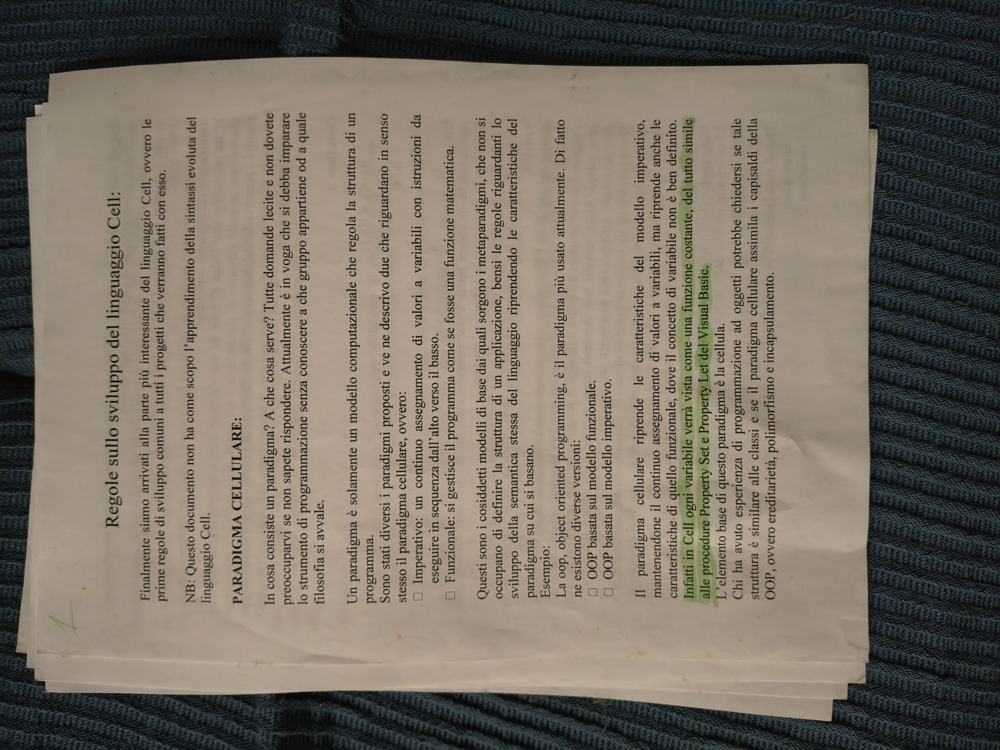

# Trascrizione — Regole sullo sviluppo del linguaggio Cell

| | |
| --- | --- |
| Foto | [IMG_20261013_202541865_HDR.jpg](../IMG_20261013_202541865_HDR.jpg) |
| Scatto | 13 ottobre 2026 |
| Supporto | Foglio stampato. Nell’angolo in alto a sinistra c’è un «4» scritto a mano. |
| Ordine di lettura | Apertura del manuale stampato, prima del foglio numerato 2. |

La trascrizione segue il testo visibile. Non corregge ortografia né punteggiatura. L’evidenziatore verde è solo in nota.

## Testo

Regole sullo sviluppo del linguaggio Cell:

Finalmente siamo arrivati alla parte più interessante del linguaggio Cell, ovvero le prime regole di sviluppo comuni a tutti i progetti che verranno fatti con esso.

NB: Questo documento non ha come scopo l’apprendimento della sintassi evoluta del linguaggio Cell.

PARADIGMA CELLULARE:

In cosa consiste un paradigma? A che cosa serve? Tutte domande lecite e non dovete preoccuparvi se non sapete rispondere. Attualmente è in voga che si debba imparare lo strumento di programmazione senza conoscere a che gruppo appartiene od a quale filosofia si avvale.

Un paradigma è solamente un modello computazionale che regola la struttura di un programma.
Sono stati diversi i paradigmi proposti e ve ne descrivo due che riguardano in senso stesso il paradigma cellulare, ovvero:

- Imperativo: un continuo assegnamento di valori a variabili con istruzioni da eseguire in sequenza dall’alto verso il basso.
- Funzionale: si gestisce il programma come se fosse una funzione matematica.

Questi sono i cosiddetti modelli di base dai quali sorgono i metaparadigmi, che non si occupano di definire la struttura di un’applicazione, bensì le regole riguardanti lo sviluppo della semantica stessa del linguaggio riprendendo le caratteristiche del paradigma su cui si basano.
Esempio:
La oop, object oriented programming, è il paradigma più usato attualmente. Di fatto ne esistono diverse versioni:

- OOP basata sul modello funzionale.
- OOP basata sul modello imperativo.

Il paradigma cellulare riprende le caratteristiche del modello imperativo, mantenendone il continuo assegnamento di valori a variabili, ma riprende anche le caratteristiche di quello funzionale, dove il concetto di variabile non è ben definito. Infatti in Cell ogni variabile verrà vista come una funzione costante, del tutto simile alle procedure Property Set e Property Let del Visual Basic.
L’elemento base di questo paradigma è la cellula.
Chi ha avuto esperienza di programmazione ad oggetti potrebbe chiedersi se tale struttura è similare alle classi e se il paradigma cellulare assimila i capisaldi della OOP, ovvero ereditarietà, polimorfismo e incapsulamento.

## Note di lettura

- Passo evidenziato in verde: «Infatti in Cell ogni variabile verrà vista come una funzione costante, del tutto simile alle procedure Property Set e Property Let del Visual Basic.»
- Il foglio prosegue nella facciata sinistra di [IMG_20261013_203112574_HDR.jpg](../IMG_20261013_203112574_HDR.jpg).
