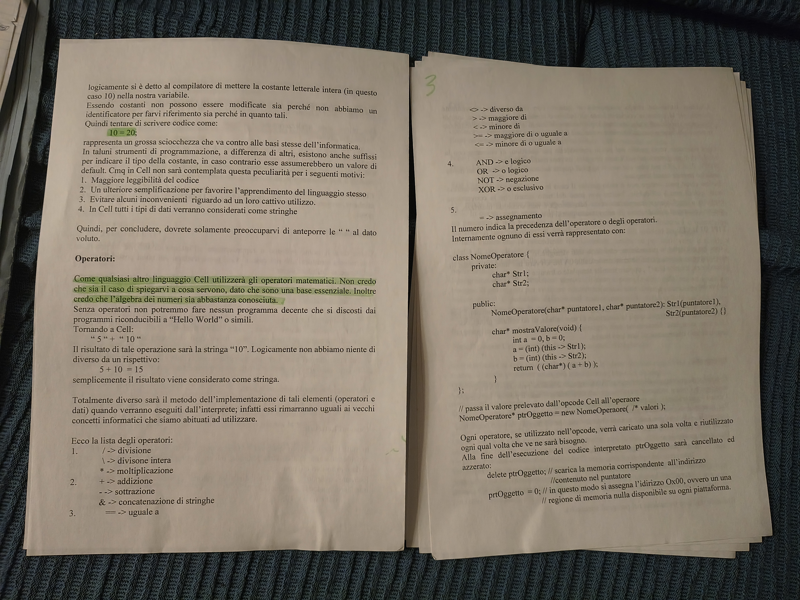

# Trascrizione — Costanti, operatori e pagina 3

| | |
| --- | --- |
| Foto | [IMG_20261013_202702872_HDR.jpg](../IMG_20261013_202702872_HDR.jpg) |
| Scatto | 13 ottobre 2026 |
| Supporto | Due fogli stampati affiancati. A destra il numero di pagina stampato è 3. |
| Ordine di lettura | Sinistra, poi destra. La sinistra continua la pagina 2. |



## Testo — facciata sinistra

logicamente si è detto al compilatore di mettere la costante letterale intera (in questo caso 10) nella nostra variabile.
Essendo costanti non possono essere modificate sia perché non abbiamo un identificatore per farvi riferimento sia perché in quanto tali.
Quindi tentare di scrivere codice come:

```
10 = 20;
```

rappresenta un grossa sciocchezza che va contro alle basi stesse dell’informatica.
In taluni strumenti di programmazione, a differenza di altri, esistono anche suffissi per indicare il tipo della costante, in caso contrario esse assumerebbero un valore di default. Cmq in Cell non sarà contemplata questa peculiarità per i seguenti motivi:

1. Maggiore leggibilità del codice
2. Un’ulteriore semplificazione per favorire l’apprendimento del linguaggio stesso
3. Evitare alcuni inconvenienti riguardo ad un loro cattivo utilizzo.
4. In Cell tutti i tipi di dati verranno considerati come stringhe

Quindi, per concludere, dovrete solamente preoccuparvi di anteporre le " " al dato voluto.

Operatori:

Come qualsiasi altro linguaggio Cell utilizzerà gli operatori matematici. Non credo che sia il caso di spiegarvi a cosa servono, dato che sono una base essenziale. Inoltre credo che l’algebra dei numeri sia abbastanza conosciuta.
Senza operatori non potremmo fare nessun programma decente che si discosti dai programmi riconducibili a "Hello World" o simili.
Tornando a Cell:

```
" 5 " + " 10 "
```

Il risultato di tale operazione sarà la stringa "10". Logicamente non abbiamo niente di diverso da un rispettivo:

```
5 + 10 = 15
```

semplicemente il risultato viene considerato come stringa.

Totalmente diverso sarà il metodo dell’implementazione di tali elementi (operatori e dati) quando verranno eseguiti dall’interprete; infatti essi rimarranno uguali ai vecchi concetti informatici che siamo abituati ad utilizzare.

Ecco la lista degli operatori:

1. / => divisione
   \ => divisione intera
   * => moltiplicazione
2. + => addizione
   - => sottrazione
   & => concatenazione di stringhe
3. == => uguale a

## Testo — facciata destra, pagina 3

```
<> => diverso da
>  => maggiore di
<  => minore di
>= => maggiore di o uguale a
<= => minore di o uguale a
```

4. AND => e logico
   OR  => o logico
   NOT => negazione
   XOR => o esclusivo

5. = => assegnamento

Il numero indica la precedenza dell’operatore o degli operatori.
Internamente ognuno di essi verrà rappresentato con:

```
class NomeOperatore {
    private:
        char* Str1;
        char* Str2;

    public:
        NomeOperatore(char* puntatore1, char* puntatore2): Str1(puntatore1),
                                                           Str2(puntatore2) {}

        char* mostraValore(void) {
            int a = 0, b = 0;
            a = (int) (this -> Str1);
            b = (int) (this -> Str2);
            return ( (char*) (a + b) );
        }
};

// passa il valore prelevato dall’opcode Cell all’operatore
NomeOperatore* ptrOggetto = new NomeOperatore( /* valori */ );

Ogni operatore, se utilizzato nell’opcode, verrà caricato una sola volta e riutilizzato
ogni qual volta che ve ne sarà bisogno.
Alla fine dell’esecuzione del codice interpretato ptrOggetto sarà cancellato ed
azzerato:

delete ptrOggetto; // scarica la memoria corrispondente all’indirizzo
                   // contenuto nel puntatore
ptrOggetto = 0; // in questo modo si assegna l’indirizzo 0x00, ovvero un una
                // regione di memoria nulla disponibile su ogni piattaforma.
```

## Note di lettura

- Evidenziati in verde: `10 = 20;` e «Come qualsiasi altro linguaggio Cell utilizzerà gli operatori matematici.»
- «un grossa sciocchezza» è stampato così.
- Il risultato dichiarato di `" 5 " + " 10 "` è la stringa "10". Può essere un refuso di stampa rispetto a "15" o a "510"; è lasciato com’è.
- L’esempio C++ chiude la classe e poi continua in prosa dentro lo stesso blocco visivo. Le righe dopo `ptrOggetto = new ...` sono testo del manuale, non codice.
- «un una regione» è stampato così.
- La frase sull’ultima istruzione `delete` continua in [IMG_20261013_202730415_HDR.jpg](../IMG_20261013_202730415_HDR.jpg).
