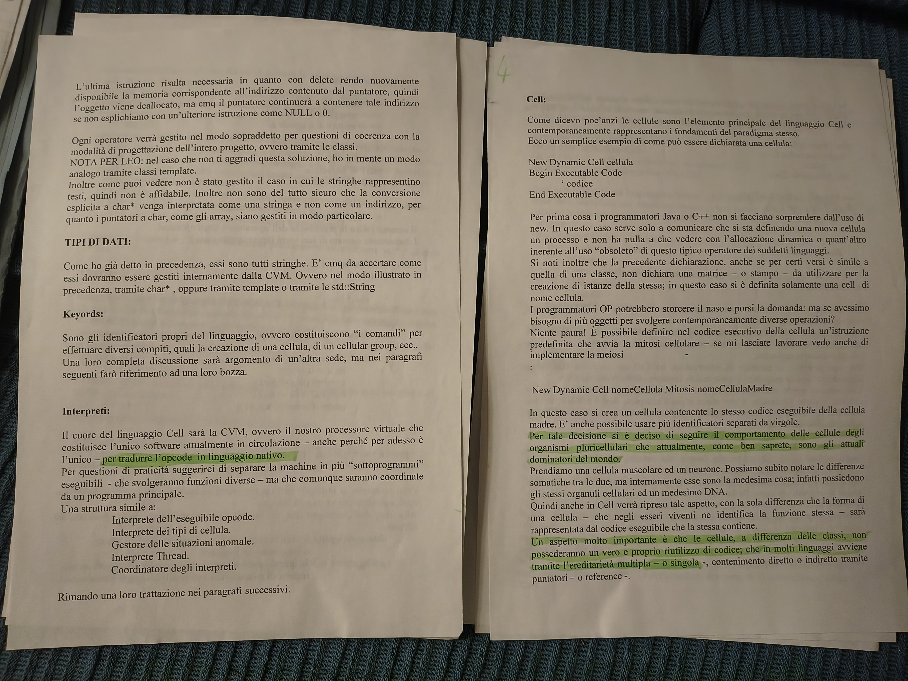

# Trascrizione — Tipi, interpreti e pagina 4, la cellula

| | |
| --- | --- |
| Foto | [IMG_20261013_202730415_HDR.jpg](../IMG_20261013_202730415_HDR.jpg) |
| Scatto | 13 ottobre 2026 |
| Supporto | Due fogli stampati affiancati. A destra il numero di pagina stampato è 4. |
| Ordine di lettura | Sinistra, poi destra. |



## Testo — facciata sinistra

L’ultima istruzione risulta necessaria in quanto con delete rendo nuovamente disponibile la memoria corrispondente all’indirizzo contenuto dal puntatore, quindi l’oggetto viene deallocato, ma cmq il puntatore continuerà a contenere tale indirizzo se non esplicitiamo con un’ulteriore istruzione come NULL o 0.

Ogni operatore verrà gestito nel modo sopradetto per questioni di coerenza con la modalità di progettazione dell’intero progetto, ovvero tramite le classi.
NOTA PER LEO: nel caso che non ti aggradi questa soluzione, ho in mente un modo analogo tramite classi template.
Inoltre come puoi vedere non è stato gestito il caso in cui le stringhe rappresentino testi, quindi non è affidabile. Inoltre non sono del tutto sicuro che la conversione esplicita a char* venga interpretata come una stringa e non come un indirizzo, per quanto i puntatori a char, come gli array, siano gestiti in modo particolare.

TIPI DI DATI:

Come ho già detto in precedenza, essi sono tutti stringhe. E’ cmq da accertare come essi dovranno essere gestiti internamente dalla CVM. Ovvero nel modo illustrato in precedenza, tramite char* , oppure tramite template o tramite le std::String

Keywords:

Sono gli identificatori propri del linguaggio, ovvero costituiscono "i comandi" per effettuare diversi compiti, quali la creazione di una cellula, di un cellular group, ecc..
Una loro completa discussione sarà argomento di un’altra sede, ma nei paragrafi seguenti farò riferimento ad una loro bozza.

Interpreti:

Il cuore del linguaggio Cell sarà la CVM, ovvero il nostro processore virtuale che costituisce l’unico software attualmente in circolazione – anche perché per adesso è l’unico – per tradurre l’opcode in linguaggio nativo.
Per questioni di praticità suggerirei di separare la machine in più "sottoprogrammi" eseguibili - che svolgeranno funzioni diverse — ma che comunque saranno coordinate da un programma principale.
Una struttura simile a:

- Interprete dell’eseguibile opcode.
- Interprete dei tipi di cellula.
- Gestore delle situazioni anomale.
- Interprete Thread.
- Coordinatore degli interpreti.

Rimando la loro trattazione nei paragrafi successivi.

## Testo — facciata destra, pagina 4

Cell:

Come dicevo poc’anzi le cellule sono l’elemento principale del linguaggio Cell e contemporaneamente rappresentano i fondamenti del paradigma stesso.
Ecco un semplice esempio di come può essere dichiarata una cellula:

```
New Dynamic Cell cellula
Begin Executable Code
    ' codice
End Executable Code
```

Per prima cosa i programmatori Java o C++ non si facciano sorprendere dall’uso di new. In questo caso serve solo a comunicare che si sta definendo una nuova cellula un processo e non ha nulla a che vedere con l’allocazione dinamica o quant’altro inerente all’uso "obsoleto" di questo tipico operatore dei suddetti linguaggi.
Si noti inoltre che la precedente dichiarazione, anche se per certi versi è simile a quella di una classe, non dichiara una matrice - o stampo - da utilizzare per la creazione di istanze della stessa; in questo caso si è definita solamente una cell di nome cellula.
I programmatori OP potrebbero storcere il naso e porsi la domanda: ma se avessimo bisogno di più oggetti per svolgere contemporaneamente diverse operazioni?
Niente paura! E’ possibile definire nel codice esecutivo della cellula un’istruzione predefinita che avvia la mitosi cellulare – se mi lasciate lavorare vedo anche di implementare la melosi -

```
New Dynamic Cell nomeCellula Mitosis nomeCellulaMadre
```

In questo caso si crea una cellula contenente lo stesso codice eseguibile della cellula madre. E’ anche possibile usare più identificatori separati da virgole.
Per tale decisione si è deciso di seguire il comportamento delle cellule degli organismi pluricellulari che attualmente, come ben saprete, sono gli attuali dominatori del mondo.
Prendiamo una cellula muscolare ed un neurone. Possiamo subito notare le differenze somatiche tra le due, ma internamente sono la medesima cosa; infatti possiedono gli stessi organuli cellulari ed un medesimo DNA.
Quindi anche in Cell verrà ripreso tale aspetto, con la sola differenza che la forma di una cellula - che negli esseri viventi ne identifica la funzione stessa - sarà rappresentata dal codice eseguibile che la cellula contiene.
Un aspetto molto importante è che le cellule, a differenza delle classi, non possederanno un vero e proprio riutilizzo di codice; che in molti linguaggi avviene tramite l’ereditarietà multipla – o singola -, contenimento diretto o indiretto tramite puntatori – o reference -.

## Note di lettura

- «tutti stringhe», «un grossa» nel foglio precedente, «melosi» e «un’istruzione» sono lasciati come si leggono. «melosi» può essere un refuso per «meiosi».
- «programmatori OP» è stampato così; può voler dire OO.
- «std::String» è stampato con la S maiuscola.
- Evidenziato in verde: «Un aspetto molto importante è che le cellule, a differenza delle classi…»
- Il paragrafo sul contenimento continua in [IMG_20261013_202756196_HDR.jpg](../IMG_20261013_202756196_HDR.jpg).
