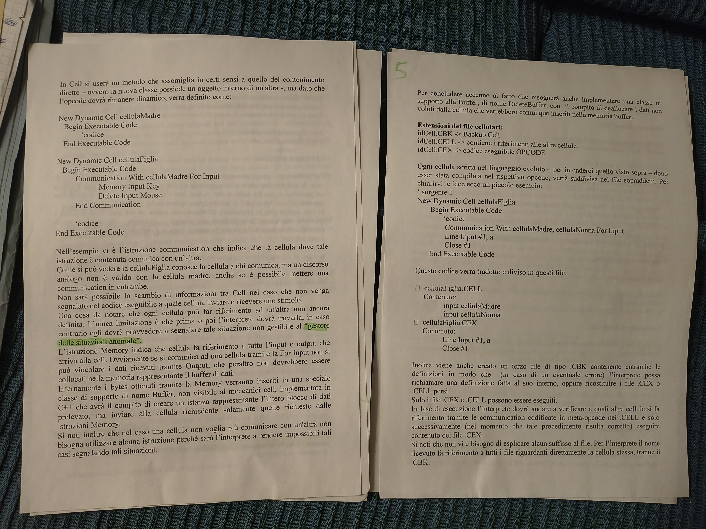

# Trascrizione — Comunicazione fra cellule e pagina 5, i file

| | |
| --- | --- |
| Foto | [IMG_20261013_202756196_HDR.jpg](../IMG_20261013_202756196_HDR.jpg) |
| Scatto | 13 ottobre 2026 |
| Supporto | Due fogli stampati affiancati. A destra il numero di pagina stampato è 5. |
| Ordine di lettura | Sinistra, poi destra. |



## Testo — facciata sinistra

In Cell si userà un metodo che assomiglia in certi sensi a quello del contenimento diretto – ovvero la nuova classe possiede un oggetto interno di un’altra -, ma dato che l’opcode dovrà rimanere dinamico, verrà definito come:

```
New Dynamic Cell cellulaMadre
Begin Executable Code
    'codice
End Executable Code

New Dynamic Cell cellulaFiglia
Begin Executable Code
    Communication With cellulaMadre For Input
        Memory Input Key
        Delete Input Mouse
    End Communication

    'codice
End Executable Code
```

Nell’esempio vi è l’istruzione communication che indica che la cellula dove tale istruzione è contenuta comunica con un’altra.
Come si può vedere la cellulaFiglia conosce la cellula a chi si comunica, ma un discorso analogo non è valido con la cellula madre, anche se è possibile mettere una communication in entrambe.
Non sarà possibile lo scambio di informazioni tra Cell nel caso che non venga segnalato nel codice eseguibile a quale cellula inviare o ricevere uno stimolo.
Una cosa da notare che ogni cellula può far riferimento ad un’altra non ancora definita. L’unica limitazione è che prima o poi l’interprete dovrà trovarla, in caso contrario egli dovrà provvedere a segnalare tale situazione non gestibile al "gestore delle situazioni anomale".
L’istruzione Memory indica che cellula fa riferimento a tutto l’input o output che arriva alla cell. Ovviamente se si comunica ad una cellula tramite la For Input non si può vincolare i dati ricevuti tramite Output, che peraltro non dovrebbero essere collocati nella memoria rappresentante il buffer di dati.
Internamente i bytes ottenuti tramite la Memory verranno inseriti in una speciale classe di supporto di nome Buffer, non visibile ai meccanismi cell, implementata in C++ che avrà il compito di creare un istanza rappresentante l’intero blocco di dati prelevato, ma inviare alla cellula richiedente solamente quelle richieste dalle istruzioni Memory.
Si noti inoltre che nel caso una cellula non voglia più comunicare con un’altra non bisogna utilizzare alcuna istruzione perché sarà l’interprete a rendere impossibili tali casi segnalando tali situazioni.

## Testo — facciata destra, pagina 5

Per concludere accenno al fatto che bisognerà anche implementare una classe di supporto alla Buffer, di nome DeleteBuffer, con il compito di deallocare i dati non voluti dalla cellula che verrebbero comunque inseriti nella memoria buffer.

Estensioni dei file cellulari:

- idCell.CBK -> Backup Cell
- idCell.CELL -> contiene i riferimenti alle altre cellule
- idCell.CEX -> codice eseguibile OPCODE

Ogni cellula scritta nel linguaggio evoluto – per intenderci quello visto sopra – dopo esser stata compilata nel rispettivo opcode, verrà suddivisa nei file sopradetti. Per chiarirvi le idee ecco un piccolo esempio.

' sorgente 1

```
New Dynamic Cell cellulaFiglia
Begin Executable Code
    'codice
    Communication With cellulaMadre, cellulaNonna For Input
        Line Input #1, a
    Close #1
End Executable Code
```

Questo codice verrà tradotto e diviso in questi file:

- cellulaFiglia.CELL
  Contenuto:
  input cellulaMadre
  input cellulaNonna
- cellulaFiglia.CEX
  Contenuto:
  Line Input #1, a
  Close #1

Inoltre viene anche creato un terzo file di tipo .CBK contenente entrambe le definizioni in modo che (in caso di un eventuale errore) l’interprete possa richiamare una definizione fatta al suo interno, oppure ricostituire i file .CEX o .CELL persi.

Solo i file .CEX e .CELL possono essere eseguiti.
In fase di esecuzione l’interprete dovrà andare a verificare a quali altre cellule si fa riferimento tramite le communication codificate in meta-opcode nei .CELL e solo successivamente (nel momento che tale procedimento risulta corretto) eseguire contenuto del file .CEX.
Si noti che non vi è bisogno di esplicare alcun suffisso al file. Per l’interprete il nome ricevuto fa riferimento a tutti i file riguardanti direttamente la cellula stessa, tranne il .CBK.

## Note di lettura

- Evidenziato in verde: «gestore delle situazioni anomale».
- «creare un istanza» e «eseguire contenuto del file» sono stampati senza l’articolo.
- «a quale cellula inviare o ricevere uno stimolo» e «cellula a chi si comunica» sono lasciati come si leggono.
- Il manuale prosegue in [IMG_20261013_202807860_HDR.jpg](../IMG_20261013_202807860_HDR.jpg).
