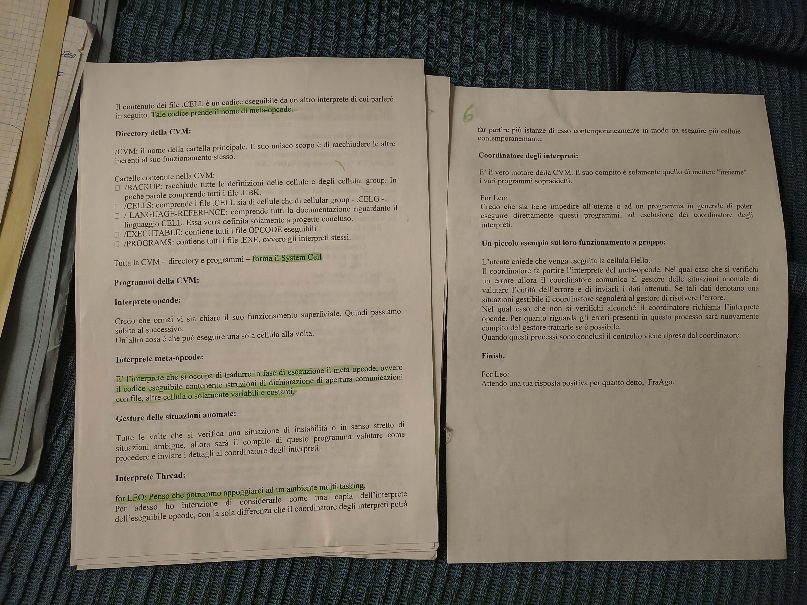

# Trascrizione — Directory della CVM e chiusa di FraAgo, pagina 6

| | |
| --- | --- |
| Foto | [IMG_20261013_202807860_HDR.jpg](../IMG_20261013_202807860_HDR.jpg) |
| Scatto | 13 ottobre 2026 |
| Supporto | Due fogli stampati affiancati. A destra il numero di pagina stampato è 6. È l’ultima pagina fotografata del manuale. |
| Ordine di lettura | Sinistra, poi destra. |

## Testo — facciata sinistra

Il contenuto dei file .CELL è un codice eseguibile da un altro interprete di cui parlerò in seguito. Tale codice prende il nome di meta-opcode.

Directory della CVM:

/CVM: il nome della cartella principale. Il suo unico scopo è di racchiudere le altre inerenti al suo funzionamento stesso.

Cartelle contenute nella CVM:

- /BACKUP: racchiude tutte le definizioni delle cellule e degli cellular group. In poche parole comprende tutti i file .CBK.
- /CELLS: comprende i file .CELL sia di cellule che di cellular group - .CELG -.
- /LANGUAGE-REFERENCE: comprende tutti la documentazione riguardante il linguaggio CELL. Essa verrà definita solamente a progetto concluso.
- /EXECUTABLE: contiene tutti i file .EXE, ovvero gli interpreti stessi.
- /PROGRAMS: contiene tutti i file .EXE, ovvero gli interpreti stessi.

Tutta la CVM – directory e programmi – forma il System Cell.

Programmi della CVM:

Interprete opcode:

Credo che ormai vi sia chiaro il suo funzionamento superficiale. Quindi passiamo subito al successivo.
Un’altra cosa è che può eseguire una sola cellula alla volta.

Interprete meta-opcode:

E’ l’interprete che si occupa di tradurre in fase di esecuzione il meta-opcode, ovvero il codice eseguibile contenente istruzioni di dichiarazione di apertura comunicazioni con file, altre cellula o solamente variabili e costanti.

Gestore delle situazioni anomale:

Tutte le volte che si verifica una situazione di instabilità o in senso stretto di situazioni ambigue, allora sarà il compito di questo programma valutare come procedere e inviare i dettagli al coordinatore degli interpreti.

Interprete Thread:

for LEO: Penso che potremmo appoggiarci ad un ambiente multi-tasking.
Per adesso ho intenzione di considerarlo come una copia dell’interprete dell’eseguibile opcode, con la sola differenza che il coordinatore degli interpreti potrà far partire più istanze di esso contemporaneamente in modo da eseguire più cellule contemporaneamente.

## Testo — facciata destra, pagina 6

Coordinatore degli interpreti:

E’ il vero motore della CVM. Il suo compito è solamente quello di mettere "insieme" i vari programmi sopradetti.

For Leo:
Credo che sia bene impedire all’utente o ad un programma in generale di poter eseguire direttamente questi programmi, ad esclusione del coordinatore degli interpreti.

Un piccolo esempio sul loro funzionamento a gruppo:

L’utente chiede che venga eseguita la cellula Hello.
Il coordinatore fa partire l’interprete del meta-opcode. Nel qual caso che si verifichi un errore allora il coordinatore comunica al gestore delle situazioni anomale di valutare l’entità dell’errore e di inviarti i dati ottenuti. Se tali dati denotano una situazione gestibile il coordinatore segnalerà al gestore di risolvere l’errore.
Nel qual caso che non si verifichi alcunché il coordinatore richiama l’interprete opcode. Per quanto riguarda gli errori presenti in questo processo sarà nuovamente compito del gestore trattarle se è possibile.
Quando questi processi sono conclusi il controllo viene ripreso dal coordinatore.

Finish.

For Leo:
Attendo una tua risposta positiva per quanto detto, FraAgo.

## Note di lettura

- Evidenziati in verde: «Tale codice prende il nome di meta-opcode.»; «forma il System Cell.»; il paragrafo dell’interprete meta-opcode; «for LEO: Penso che potremmo appoggiarci ad un ambiente multi-tasking.»
- /LANGUAGE-REFERENCE stampa «comprende tutti la documentazione».
- /EXECUTABLE e /PROGRAMS, nella lettura di questa foto, descrivono entrambi «tutti i file .EXE, ovvero gli interpreti stessi». La seconda voce può essere un errore di lettura o un refuso ripetuto: la foto resta la fonte.
- «altre cellula», «inviarti i dati», «trattarle» sono lasciati come si leggono.
- La firma è FraAgo. Il destinatario delle note è Leo.
