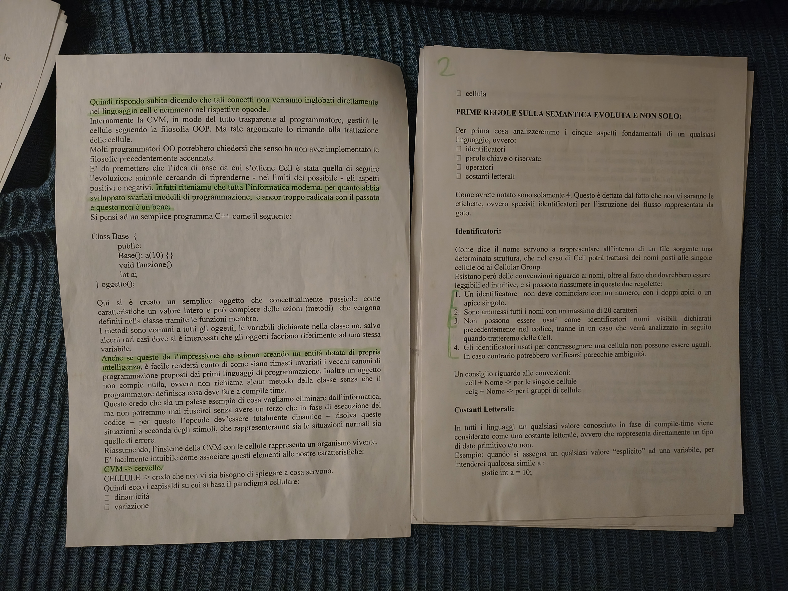

# Trascrizione — Chiusura del paradigma e pagina 2

| | |
| --- | --- |
| Foto | [IMG_20261013_203112574_HDR.jpg](../IMG_20261013_203112574_HDR.jpg) |
| Scatto | 13 ottobre 2026 |
| Supporto | Due fogli stampati affiancati. A destra il numero di pagina stampato è 2. |
| Ordine di lettura | Sinistra, poi destra. La sinistra continua [IMG_20261013_202541865_HDR.jpg](../IMG_20261013_202541865_HDR.jpg). |



## Testo — facciata sinistra

Quindi rispondo subito dicendo che tali concetti non verranno inglobati direttamente nel linguaggio cell e nemmeno nel rispettivo opcode.
Internamente la CVM, in modo del tutto trasparente al programmatore, gestirà le cellule seguendo la filosofia OOP. Ma tale argomento lo rimando alla trattazione delle cellule.
Molti programmatori OO potrebbero chiedersi che senso ha non aver implementato le filosofie precedentemente accennate.
E’ da premettere che l’idea di base da cui s’ottiene Cell è stata quella di seguire l’evoluzione animale cercando di riprenderne - nei limiti del possibile - gli aspetti positivi o negativi. Infatti riteniamo che tutta l’informatica moderna, per quanto abbia sviluppato svariati modelli di programmazione, è ancor troppo radicata con il passato e questo non è un bene.
Si pensi ad un semplice programma C++ come il seguente:

```
Class Base {
    public:
        Base(): a(10) {}
        void funzione()
        int a;
    } oggetto();
```

Qui si è creato un semplice oggetto che concettualmente possiede come caratteristiche un valore intero e può compiere delle azioni (metodi) che vengono definiti nella classe tramite le funzioni membro.
I metodi sono comuni a tutti gli oggetti, le variabili dichiarate nella classe no, salvo alcuni rari casi dove si è interessati che gli oggetti facciano riferimento ad una stessa variabile.
Anche se questo da l’impressione che stiamo creando un’entità dotata di propria intelligenza, è facile rendersi conto di come siano rimasti invariati i vecchi canoni di programmazione proposti dai primi linguaggi di programmazione. Inoltre un oggetto non compie nulla, ovvero non richiama alcun metodo della classe senza che il programmatore definisca cosa deve fare a compile time.
Questo credo che sia un palese esempio di cosa vogliamo eliminare dall’informatica, ma non potremmo mai riuscirci senza avere un terzo che in fase di esecuzione del codice — per questo l’opcode dev’essere totalmente dinamico — risolva queste situazioni a seconda degli stimoli, che rappresenteranno sia le situazioni normali sia quelle di errore.
Riassumendo, l’insieme della CVM con le cellule rappresenta un organismo vivente.
E’ facilmente intuibile come associare questi elementi alle nostre caratteristiche:

- CVM => cervello.
- CELLULE => credo che non vi sia bisogno di spiegare a cosa servono.

Quindi ecco i capisaldi su cui si basa il paradigma cellulare:

- dinamicità
- variazione

## Testo — facciata destra, pagina 2

- cellula

PRIME REGOLE SULLA SEMANTICA EVOLUTA E NON SOLO:

Per prima cosa analizzeremo i cinque aspetti fondamentali di un qualsiasi linguaggio, ovvero:

- identificatori
- parole chiave o riservate
- operatori
- costanti letterali

Come avrete notato sono solamente 4. Questo è dettato dal fatto che non vi saranno le etichette, ovvero speciali identificatori per l’istruzione del flusso rappresentata da goto.

Identificatori:

Come dice il nome servono a rappresentare all’interno di un file sorgente una determinata struttura, che nel caso di Cell potrà trattarsi dei nomi posti alle singole cellule od ai Cellular Group.
Esistono però delle convenzioni riguardo ai nomi, oltre al fatto che dovrebbero essere leggibili ed intuitive, e si possono riassumere in queste due regolette:

1. Un identificatore non deve cominciare con un numero, con i doppi apici o un apice singolo.
2. Sono ammessi tutti i nomi con un massimo di 20 caratteri
3. Non possono essere usati come identificatori nomi visibili dichiarati precedentemente nel codice, tranne in un caso che verrà analizzato in seguito quando tratteremo delle Cell.
4. Gli identificatori usati per contrassegnare una cellula non possono essere uguali. In caso contrario potremmo verificarci parecchie ambiguità.

Un consiglio riguardo alle convenzioni:

- cell + Nome => per le singole cell
- celg + Nome => per i gruppi di cellule

Costanti Letterali:

In tutti i linguaggi un qualsiasi valore conosciuto in fase di compile-time viene considerato come una costante letterale, ovvero che rappresenta direttamente un tipo di dato primitivo e/o non.
Esempio: quando si assegna un qualsiasi valore "esplicito" ad una variabile, per intenderci qualcosa simile a:

```
static int a = 10;
```

## Note di lettura

- Evidenziati in verde, facciata sinistra: il capoverso che comincia con «Quindi rispondo subito»; la frase «Infatti riteniamo che tutta l’informatica moderna… e questo non è un bene.»
- Il testo dice «cinque aspetti» e poi «sono solamente 4». La numerazione degli identificatori prosegue fino a 4 dopo «queste due regolette».
- L’esempio C++ è stampato incompleto: manca la parentesi del metodo e `oggetto();` sta fuori dalla classe. È trascritto come si legge.
- La facciata destra continua in [IMG_20261013_202702872_HDR.jpg](../IMG_20261013_202702872_HDR.jpg).
