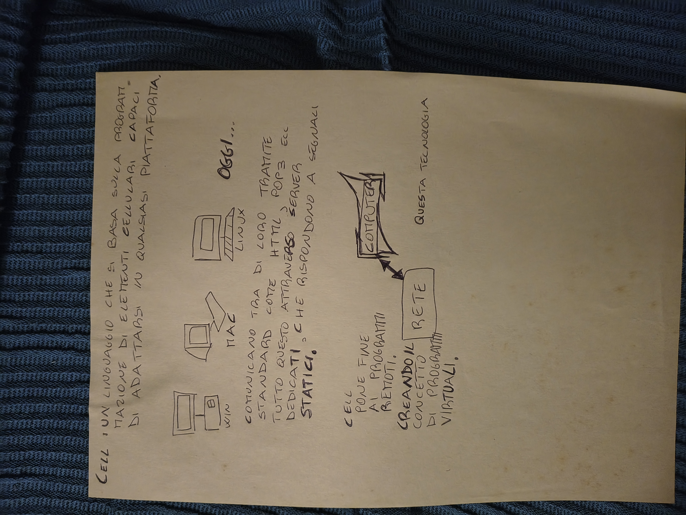

# Trascrizione — CELL è un linguaggio che si basa sulla programmazione di elementi cellulari

| | |
| --- | --- |
| Foto | [IMG_20261013_203150097_HDR.jpg](../IMG_20261013_203150097_HDR.jpg) |
| Scatto | 13 ottobre 2026 |
| Supporto | Foglio manoscritto in stampatello, ruotato. Tre disegni di computer e due riquadri. |
| Ordine di lettura | Il testo corre in verticale. Qui è riportato in righe orizzontali, dall’alto del foglio ruotato. |

## Testo

CELL : UN LINGUAGGIO CHE SI BASA SULLA PROGRAMMAZIONE DI ELEMENTI CELLULARI CAPACI DI ADATTARSI SU QUALSIASI PIATTAFORMA.

Disegni, da sinistra: un computer etichettato WIN, uno etichettato MAC, uno etichettato LINUX. Sopra i tre disegni: OGGI...

CONTINUANO TUTTI DI LORO TRAMITE STANDARD COME HTML, POP3 ECC
TUTTO QUESTO ATTRAVERSO SERVER DEDICATI CHE RISPONDONO A SEGNALI STATICI.

Freccia da un riquadro COMPUTER verso un riquadro RETE.

CELL PONE FINE AI PROGRAMMI REMOTI.
CREANDO IL CONCETTO DI PROGRAMMI VIRTUALI.

Accanto: QUESTA TECNOLOGIA

## Note di lettura

- «CONTINUANO TUTTI» si legge così; il senso atteso sarebbe «comunicano tra di loro». Non è stato corretto.
- «PROGRAMMI REMOTI» è la lettura del foglio. Una lettura alternativa, meno sicura, è «PROGRAMMI PRONTI».
- I nomi WIN, MAC, LINUX, COMPUTER e RETE sono etichette dei disegni.
