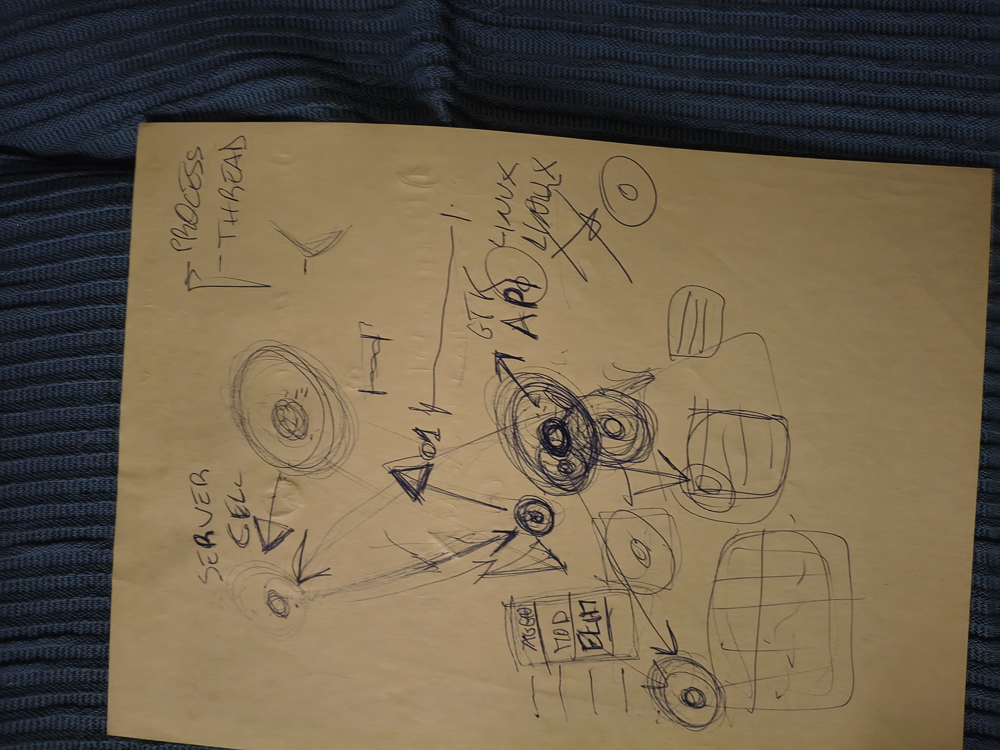

# Trascrizione — Schizzo SERVER CELL, processi e thread

| | |
| --- | --- |
| Foto | [IMG_20261013_203326854_HDR.jpg](../IMG_20261013_203326854_HDR.jpg) |
| Scatto | 13 ottobre 2026 |
| Supporto | Schizzo a penna, molto corretto e sovrascritto. Non è un testo continuo. |
| Ordine di lettura | Etichette leggibili, poi il disegno. |



## Testo leggibile

```
PROCESS
  - THREAD
```

```
SERVER
CELL
```

Nel disegno centrale, parole circolettate o barrate:

- GIT
- LINUX
- API
- LINUX, di nuovo, in parte barrato

Riquadro in basso, tre righe:

```
MSGQ
TOD
ELAT
```

Il resto sono cerchi concentrici, quadrati, frecce e tratti cancellati. Non formano una frase.

## Note di lettura

- MSGQ, TOD e ELAT sono incerti: le lettere sono piccole e il riquadro è stretto.
- Il foglio non ha un titolo. Le uniche parole sicure sono PROCESS, THREAD, SERVER e CELL.
