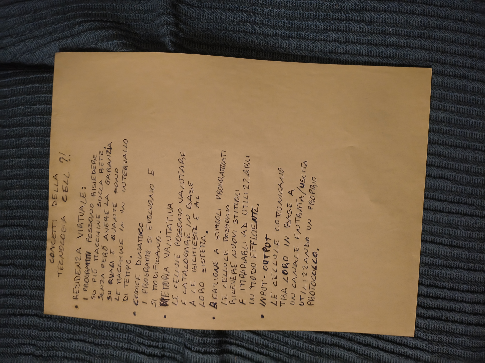

# Trascrizione — Concetti della tecnologia Cell

| | |
| --- | --- |
| Foto | [IMG_20261013_203339192_HDR.jpg](../IMG_20261013_203339192_HDR.jpg) |
| Scatto | 13 ottobre 2026 |
| Supporto | Foglio manoscritto in stampatello, ruotato di lato. |
| Ordine di lettura | Titolo, poi quattro punti. «MEMORIA VALUTATIVA» è sottolineato. |

## Testo

CONCETTI DELLA TECNOLOGIA CELL ?!

- RESIDENZA VIRTUALE:
  I PROGRAMMI POSSONO RISIEDERE
  SU PIÙ MACCHINE SULLA RETE
  SENZA PERÒ AVERE LA GARANZIA
  SU QUALI E QUANTE SONO
  LE MACCHINE IN UN INTERVALLO
  DI TEMPO.

- CODICE DINAMICO
  I PROGRAMMI SI EVOLVONO E
  SI MODIFICANO.

- MEMORIA VALUTATIVA
  LE CELLULE POSSONO VALUTARE
  E CATALOGARE IN BASE
  A LE RICHIESTE E AL
  LORO SISTEMA.

- REAZIONE A STIMOLI PROGRAMMATI
  LE CELLULE POSSONO
  RICEVERE NUOVI STIMOLI
  E IMPARARLI AD UTILIZZARLI
  IN MODO EFFICIENTE,

- INPUT-OUTPUT
  LE CELLULE COMUNICANO
  TRA LORO IN BASE A
  UN CANALE ENTRATA/USCITA
  UTILIZZANDO UN PROPRIO
  PROTOCOLLO.

## Note di lettura

- Il punto sulla memoria valutativa è sottolineato sul foglio.
- «A LE RICHIESTE» e «IMPARARLI AD UTILIZZARLI» sono lasciati come scritti.
- La virgola dopo «EFFICIENTE» è sul foglio; il punto seguente è INPUT-OUTPUT.
