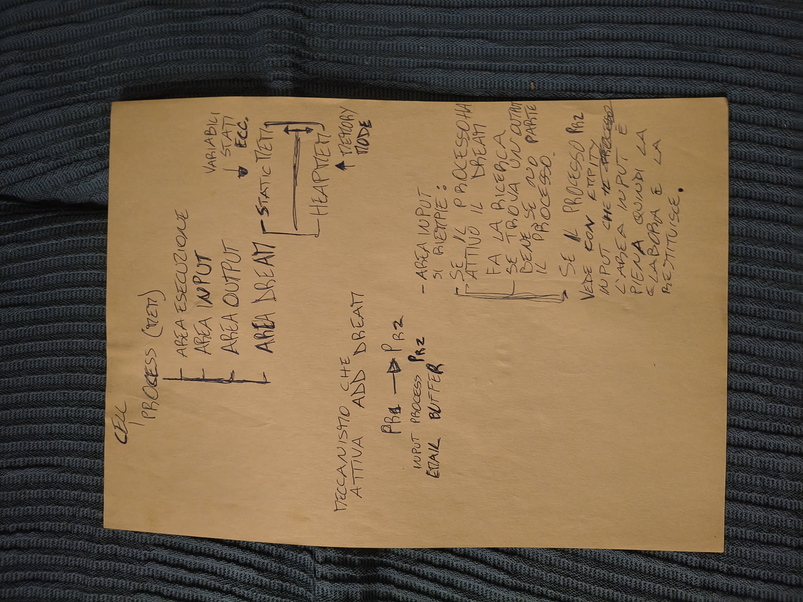

# Trascrizione — Aree del processo e meccanismo ADD DREAM

| | |
| --- | --- |
| Foto | [IMG_20261013_203434525_HDR.jpg](../IMG_20261013_203434525_HDR.jpg) |
| Scatto | 13 ottobre 2026 |
| Supporto | Foglio manoscritto con schema e due paragrafi. |
| Ordine di lettura | Schema in alto, meccanismo a sinistra, comportamento dell’area input a destra. |



## Testo

```
CELL
  PROCESS (NET)
    AREA ESECUZIONE
    AREA INPUT
    AREA OUTPUT
    AREA DREAM
```

A destra di AREA DREAM:

```
VARIABILI
STATI
ECC.
```

Sotto AREA DREAM, due rami:

```
STATIC ITEM
HEAP ITEM
    MEMORY MODE
```

MECCANISMO CHE ATTIVA ADD DREAM

```
PR1 --> PR2
INPUT PROCESS PR2
EMAIL BUFFER
```

AREA INPUT SI RIEMPIE:

- SE IL PROCESSO HA ATTIVO IL DREAM FA LA RICERCA SE TROVA UN CUTOFF BENE SE NO PARTE IL PROCESSO.
- SE IL PROCESSO PR2 VEDE CON EMPTY INPUT CHE IL PROCESSO L’AREA INPUT È PIENA QUINDI LA ELABORA E LA RESTITUISCE.

## Note di lettura

- PROCESS (NET): la parentesi è piccola. Può leggersi anche (NETT).
- STATIC ITEM e HEAP ITEM sono la lettura più stabile; una lettura alternativa è STATIC MEM e HEAP MEM.
- «CUTOFF» è incerto. Sul foglio può essere «CUT OFF» o un’altra parola breve.
- «VEDE CON EMPTY» è incerto: EMPTY è la lettura più vicina alle lettere visibili.
- EMAIL BUFFER sta sotto INPUT PROCESS PR2. Non è collegato da una frase.
