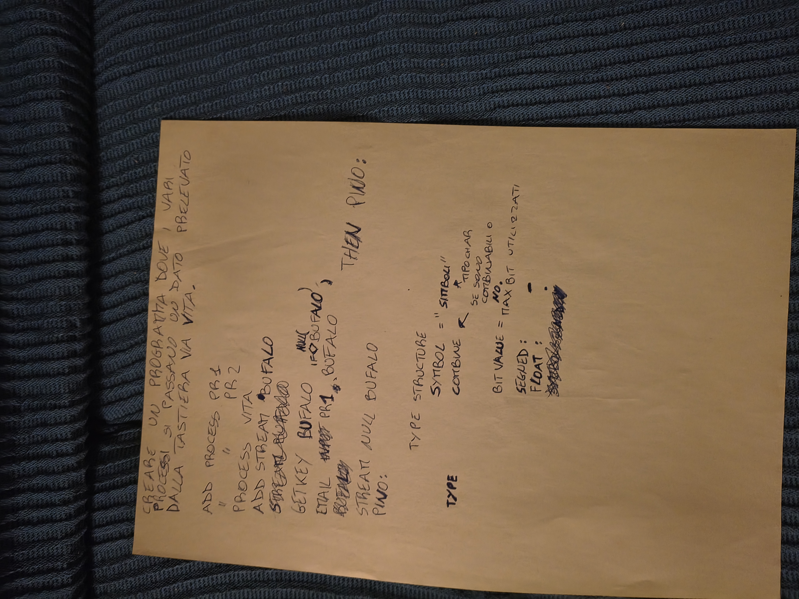

# Trascrizione — Processi, stream BUFALO e TYPE STRUCTURE

| | |
| --- | --- |
| Foto | [IMG_20261013_203439880_HDR.jpg](../IMG_20261013_203439880_HDR.jpg) |
| Scatto | 13 ottobre 2026 |
| Supporto | Foglio manoscritto. La metà alta è un programma con righe cancellate. La metà bassa è uno schema di tipo. |
| Ordine di lettura | Programma dall’alto, poi TYPE STRUCTURE. Le righe barrate sono trascritte e segnate. |



## Testo

CREARE UN PROGRAMMA DOVE I VARI PROCESSI SI PASSANO UN DATO PRELEVATO DALLA TASTIERA VIA VITA.

```
ADD PROCESS PR1
"            PR2
PROCESS VITA
ADD STREAM BUFALO
STREAM BUFALO()          [riga barrata]
GETKEY BUFALO
ETAIL INPUT PR1, BUFALO  [INPUT barrato; a destra: NULL IF(BUFALO)]
BUFALO                   [riga barrata]
STREAM NULL BUFALO
PINO:
                         THEN PINO:
```

TYPE STRUCTURE

```
TYPE

SYMBOL = "SIMBOLI"
COMBINE
    TIPO CHAR
    SE SONO COMBINABILI O NO.

BIT VALUE = MAX BIT UTILIZZATI

SEGUE:
FLOAT:
```

L’ultima riga sotto FLOAT è cancellata con un tratto e non si legge.

## Note di lettura

- BUFALO è scritto così, non BUFFER.
- ETAIL è la lettura delle lettere. Può essere un tentativo di EMAIL o di un’altra parola, poi in parte corretto: INPUT è barrato.
- THEN PINO: sta a destra, all’altezza delle righe cancellate, non incolonnato con PINO:.
- «SIMBOLI» è tra virgolette. COMBINE ha una freccia verso le due note su CHAR e sulla combinabilità.
