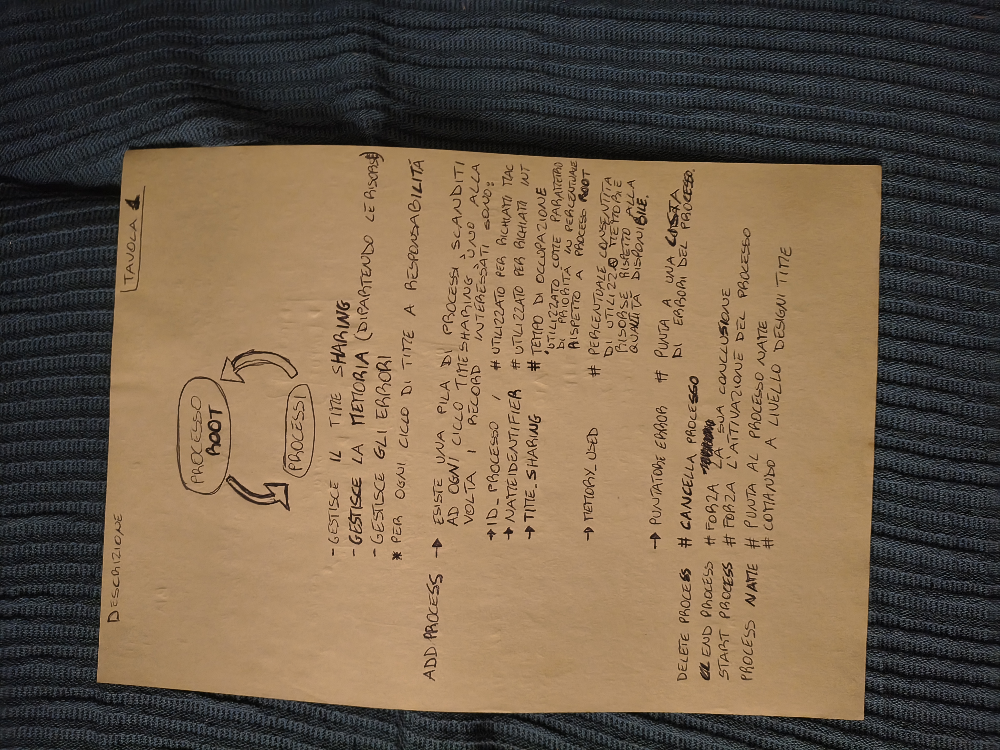

# Trascrizione — Tavola 1, processo root e time sharing

| | |
| --- | --- |
| Foto | [IMG_20261013_203531471_HDR.jpg](../IMG_20261013_203531471_HDR.jpg) |
| Scatto | 13 ottobre 2026 |
| Supporto | Foglio manoscritto ruotato. In alto, a sinistra del foglio ruotato, c’è «TAVOLA 1». In basso a sinistra, in verticale, «DESCRIZIONE». |
| Ordine di lettura | Diagramma, poi l’elenco ADD PROCESS, poi il blocco DELETE / END / START. |



## Testo

TAVOLA 1

DESCRIZIONE

Due ovali, PROCESSO ROOT e PROCESSI, collegati da frecce curve nei due sensi.

- GESTISCE IL TIME SHARING
- GESTISCE LA MEMORIA (RIPARTENDO LE AREE)
- GESTISCE GLI ERRORI

* PER OGNI CICLO DI TIME A RESPONSABILITÀ

ADD PROCESS

ESISTE UNA PILA DI PROCESSI SCANDITI AD OGNI CICLO TIMESHARING, OGNI VOLTA I RECORD INTERESSANTI SONO:

- ID. PROCESSO / # UTILIZZATO PER FIRMARLI [?]
- NAME IDENTIFIER
- TIME SHARING # TEMPO DI OCCUPAZIONE, UTILIZZATO COME PARAMETRO DI PRIORITÀ. LA PERCENTUALE RISPETTO A PROCESSO ROOT
- MEMORY USED # PERCENTUALE CASSETTA UTILIZZATA. IL TETTO È FISSO E IL RESTO È LA QUANTITÀ DISPONIBILE.
- PUNTEGGIO ERRORI # PUNTA A UNA CASTA DI ERRORI DEL PROCESSO.

```
DELETE PROCESS  # CANCELLA PROCESSO
END PROCESS     # FORZA LA SUA CONCLUSIONE
START PROCESS   # FORZA L’ATTIVAZIONE DEL PROCESSO
PROCESS NAME    # PUNTA AL PROCESSO NAME
                # CONTANDO A LIVELLO DESIGN TIME
```

## Note di lettura

- «TETTO» nel time sharing è incerto: le lettere possono leggersi anche «TITOLO».
- «CASTA DI ERRORI» è la lettura visibile. Il senso atteso sarebbe «lista» o «casta» lasciata com’è; non è stato sostituito.
- «FIRMARLI» nel campo ID è incerto.
- «RIPARTENDO LE AREE» è tra parentesi sul foglio, accanto a GESTISCE LA MEMORIA.
- Il foglio è denso e diverse parole di raccordo sono abbreviate. Dove la lettura non è stabile c’è [?].
