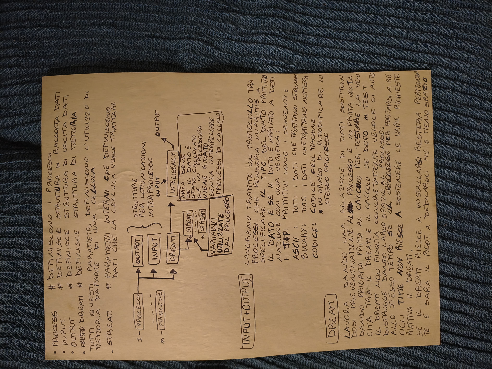

# Trascrizione — Process, stream, dream e verifica del dato

| | |
| --- | --- |
| Foto | [IMG_20261013_203536321_HDR.jpg](../IMG_20261013_203536321_HDR.jpg) |
| Scatto | 13 ottobre 2026 |
| Supporto | Foglio manoscritto fitto, ruotato, con uno schema al centro e un riquadro DREAM in basso. |
| Ordine di lettura | Elenco a sinistra, schema, poi i due blocchi di prosa a destra, poi il riquadro DREAM. |



## Testo — elenco

```
# DEFINISCONO I PROCESSI
# DEFINISCE STRUTTURA DI RACCOLTA DATI
  - PROCESS
  - INPUT
  - OUTPUT
# DEFINISCE STRUTTURA DI USCITA DATI
# CREA DREAM
# DEFINISCE PARAMETRI, DEFINISCONO L’UTILIZZO DI
  MEMORIA DA PARTE DI UNA CELLULA
# TUTTI QUESTI PARAMETRI INTERNI CHE DEFINISCONO
  I DATI CHE LA CELLULA VUOLE TRATTARE
- STREAM
```

## Testo — schema

PROCESS si divide in OUTPUT, INPUT, DREAM.

DREAM contiene VARIABILI UTILIZZATE DAL PROCESSO.

Una freccia da INPUT+OUTPUT entra in STRUTTURE PER COMUNICAZIONI INTERPROCESSO, che si apre su INPUT e OUTPUT.

Sopra, un riquadro INTELLIGENCE / AREA DOVE SE IL DATO È STATO CALCOLATO VIENE AIDATO SENZA INTERPELLARE PROCESSI DI CALCOLO.

Accanto a STREAM è scritto 1500 GT, lettura incerta.

## Testo — verifica

LAVORANO TRAMITE UN PROTOCOLLO TRA PROCESSI CHE PENSERÀ L’ALGORITMO A SPECIFICARE IL TIPO DEL DATO PRIMITIVO. IL DATO E SE IL DATO È ARRIVATO A DESTINAZIONE CON UNA VERIFICA:

- RAP. : TUTTI I DATI CHE TRATTANO STAMPARE [?]
- ASCII : TUTTI I DATI CHE TRATTANO NUMERI
- BINARY : CODICE CELL MACHINE
- CODICE : * IN GRADO DI AUTODIFICARE LO STESSO PROCESSO

## Testo — riquadro DREAM

LAVORA DANDO UNA RELAZIONE DI DATI SOSTITUTI DOS PREVENTIVAMENTE AL PROCESSO E NO PRIMA VOLTA DANDO PRIORITÀ PRIMA AL CALCOLO PER TESTARE LA VELOCITÀ TRA IL DREAM E IL CALCOLO SE DOPO M TEST IL DREAM È RISULTATO CONCETTUALMENTE VELOCE SI AUTO DISTRUGGE DANDO LARGO SPAZIO AL PROCESSO. IL MEDESIMO METODO SE UN PROCESSO PER PARTIRSI HA POCHI CICLI TIME NON RIESCE A SOSTENERE LE VARIE RICHIESTE MENTRE IL DREAM RIESCE A INSTALLARSI RESTERÀ PENTENZIO TE E SARÀ IL ROOT A DEDICARGLI PIÙ O MENO SPAZIO

## Note di lettura

- «AIDATO» nel riquadro intelligence è incerto. Può leggersi «VALIDATO» o «AIUTATO».
- «1500 GT» accanto a STREAM non è stabile.
- «RAP.» è un’abbreviazione non sciolta sul foglio. La glossa «STAMPARE» è incerta.
- «PENTENZIO TE» è lasciato come si legge; non è stato normalizzato in «in pendenza» o in un’altra parola.
- «M TEST» può essere «N TEST». La lettera è una sola.
- Il foglio è la fonte. Questa trascrizione tiene le parole sicure e segna il resto.
