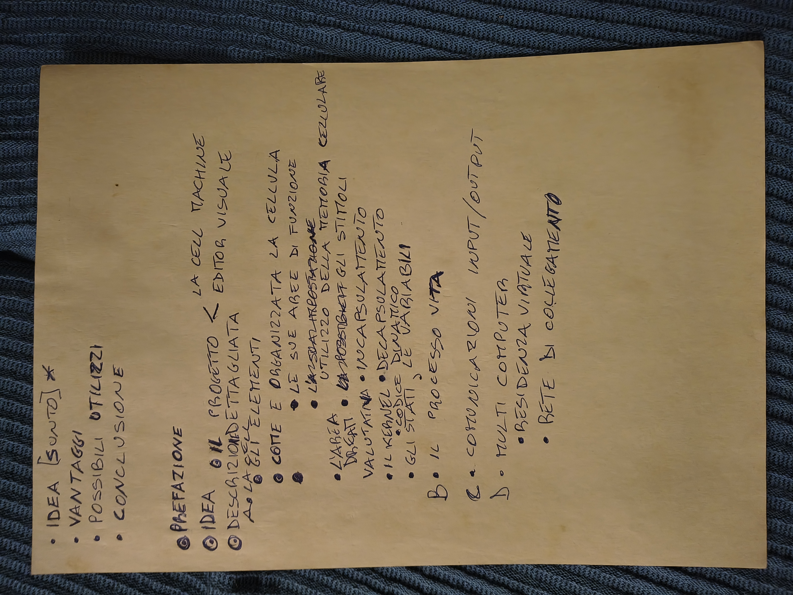

# Trascrizione — Scaletta: idea, Cell Machine, dream, vita

| | |
| --- | --- |
| Foto | [IMG_20261013_203549158_HDR.jpg](../IMG_20261013_203549158_HDR.jpg) |
| Scatto | 13 ottobre 2026 |
| Supporto | Scaletta manoscritta, ruotata. È un indice, non un testo continuo. |
| Ordine di lettura | Dall’alto del foglio ruotato: i quattro punti, poi A, B, C, D. |

## Testo

- IDEA [PUNTO] *
- VANTAGGI UTILIZZI
- POSSIBILI CONCLUSIONE

A. PREFAZIONE

B. IDEA DI IL PROGETTO < LA CELL MACHINE

C. DESCRIZIONE DETTAGLIATA
   - LA GLI ELEMENTI
   - COME È ORGANIZZATA LA CELLULA
     - LE SUE AREE DI FUNZIONE
     - L’INSTALLAZIONE
     - L’AREA DREAM
       - UTILIZZO DELLA MEMORIA CELLULARE
       - LA POSSIBILITÀ DI STIMOLI
       - VALUTATIVA
       - INCAPSULAMENTO
     - IL KERNEL
       - CODICE DINAMICO
       - GLI STATI, LE VARIABILI
     - IL PROCESSO VITA

D. COMUNICAZIONI INPUT/OUTPUT

E. MULTI COMPUTER
   - RESIDENZA VIRTUALE
   - RETE DI COLLEGAMENTO

## Note di lettura

- «IDEA [PUNTO]» : dopo IDEA c’è una parola breve tra parentesi o un segno. Non è stabile; non è stato sciolto in «IDEA (PUNTO)».
- «LA GLI ELEMENTI» è scritto così.
- «L’INSTALLAZIONE» può leggersi anche «L’INSTALLAZIONE / L’INCAPSULAZIONE» in un altro punto del foglio. Qui le due voci restano distinte: installazione sotto le aree, incapsulamento sotto l’area dream.
- Le lettere A B C D E sono sul foglio. Il primo elenco non ha lettera.
- «PROCESS VITA» nell’immagine è sottolineato o scritto in evidenza rispetto alle voci vicine.
