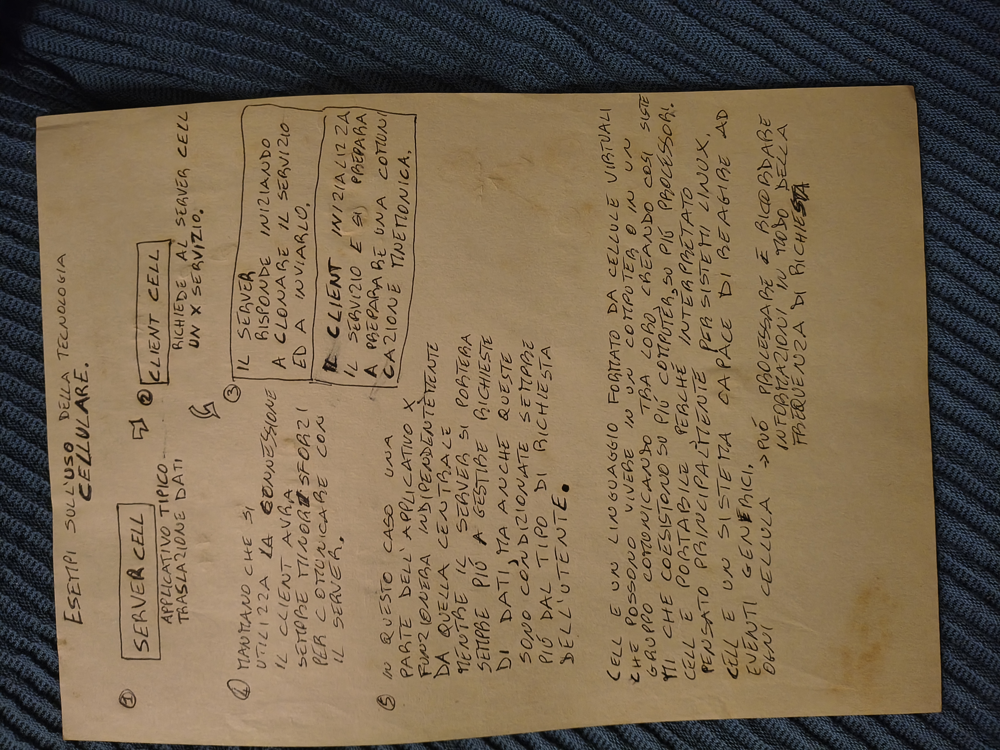

# Trascrizione — Esempi sull’uso della tecnologia cellulare

| | |
| --- | --- |
| Foto | [IMG_20261013_203625538_HDR.jpg](../IMG_20261013_203625538_HDR.jpg) |
| Scatto | 13 ottobre 2026 |
| Supporto | Foglio manoscritto ruotato. Schema a riquadri e cinque punti numerati, poi un paragrafo. |
| Ordine di lettura | Titolo, riquadri 1-2-3, punti 4 e 5, paragrafo a destra. |

## Testo

ESEMPI SULL’USO DELLA TECNOLOGIA CELLULARE.

Riquadro 1, SERVER CELL: APPLICATIVO TIPO TRASLAZIONE DATI

Riquadro 2, CLIENT CELL: RICHIEDE AL SERVER CELL UN X SERVIZIO.

Riquadro 3:

IL SERVER INIZIANDO RISPONDE A CLONARE IL SERVIZIO ED A INVIARLO.

IL CLIENT INIZIALIZZA IL SERVIZIO E SI PREPARA A PRELEVARE UNA COMUNICAZIONE TIMETONICA.

4. INIZIANDO CHE SI UTILIZZA LA CONNESSIONE IL CLIENT AVRÀ SEMPRE MINORI SFORZI PER COMUNICARE CON IL SERVER.

5. IN QUESTO CASO UNA PARTE DELL’APPLICATIVO X FUNZIONERÀ INDIPENDENTEMENTE DA QUELLA CENTRALE MENTRE IL SERVER SI PORTERÀ SEMPRE PIÙ A GESTIRE RICHIESTE DI DATI, MA ANCHE QUESTE SONO CONDIZIONATE SEMPRE PIÙ DAL TIPO DI RICHIESTA DELL’UTENTE.

CELL È UN LINGUAGGIO FORMATO DA CELLULE VIRTUALI CHE POSSONO VIVERE IN UN COMPUTER O IN UN GRUPPO COMUNICANDO TRA LORO CREANDO COSÌ SISTEMI CHE COESISTONO SU PIÙ COMPUTER SU PIÙ PROCESSORI. CELL È PORTABILE PERCHÉ INTERPRETATO. PENSATO PRINCIPALMENTE PER SISTEMI LINUX. CELL È UN SISTEMA CAPACE DI REAGIRE AD EVENTI GENERICI.

DELLA CELLULA -> PUÒ PROCESSARE E RICORDARE INFORMAZIONI IN MODO DELLA FREQUENZA DI RICHIESTA

## Note di lettura

- «TRASLAZIONE DATI» può leggersi anche «TRADUZIONE DATI». Le lettere centrali non sono nette.
- «COMUNICAZIONE TIMETONICA» è la lettura del riquadro 3. Non è una parola corretta in italiano ed è lasciata così. Un’alternativa meno sicura è «COMUNICAZIONE TIME TONICA».
- «INIZIANDO CHE SI UTILIZZA» è scritto così, senza «dal momento».
- L’ultima riga, con la freccia «DELLA CELLULA», sta in verticale sul margine ed è la più incerta del foglio.
