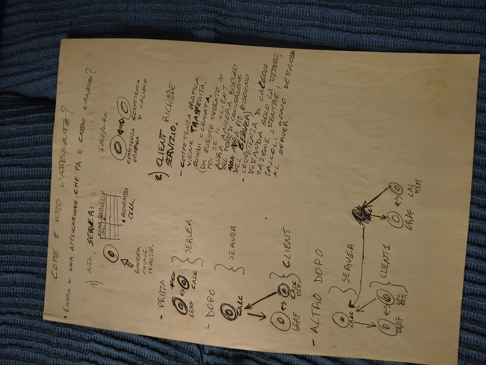

# Trascrizione — Come è visto l’ambiente

| | |
| --- | --- |
| Foto | [IMG_20261013_203632404_HDR.jpg](../IMG_20261013_203632404_HDR.jpg) |
| Scatto | 13 ottobre 2026 |
| Supporto | Foglio manoscritto ruotato. Testo in alto e tre schemi: PRIMA, DOPO, ALTRA DOPO. |
| Ordine di lettura | Domanda, punto 1, punto 2, poi i tre schemi da sinistra a destra. |

## Testo

COME È VISTO L’AMBIENTE?

- ESEMPIO DI UNA APPLICAZIONE CHE FA IL CALCOLO LIBRERIA?

1) NEL SERVER:

Due cerchi collegati: COMPETENZA GRAFICA e COMPETENZA DI CALCOLO. Una freccia sale verso un riquadro PROGRAMMA CELL. Sotto: RICHIESTA DI SERVIZIO.

2) CLIENT RICHIEDE SERVIZIO.

- COMPETENZA GRAFICA VIENE TRASFERITA QUINDI CLONATA. DA QUESTO MOMENTO IN POI SE IL CLIENT HA FORMATO CON BISOGNO DEL CALCOLO LA VERSIONE NON AVRÀ PIÙ BISOGNO DI COMPETENZA DI CALCOLO E CALCOLERÀ SOLO LA MEMORIA, CALCOLI INTERNI, AL SERVER SOLO DETTAGLI.

Schemi, etichette ripetute GRAF e CALC:

- PRIMA: SERVER con GRAF e CALC; CLIENT separato.
- DOPO: SERVER tiene CALC; una freccia porta GRAF verso CLIENT, che ha GRAF e un cerchio MEM.
- ALTRA DOPO: SERVER tiene CALC; sotto, CLIENTI, ciascuno con GRAF e MEM. Un nodo in alto è scarabocchiato.

## Note di lettura

- «CALCOLO LIBRERIA» è incerto. Può essere «CALCOLO LIBRERIE» o «CALCOLO L’LIBRERIA».
- «FORMATA CON BISOGNO» è lasciato come si legge.
- «CALCOLERÀ SOLO LA MEMORIA» è incerto nella seconda metà della frase. La chiusura «AL SERVER SOLO DETTAGLI» è più stabile.
- GRAF, CALC e MEM sono etichette dei cerchi, non frasi.
