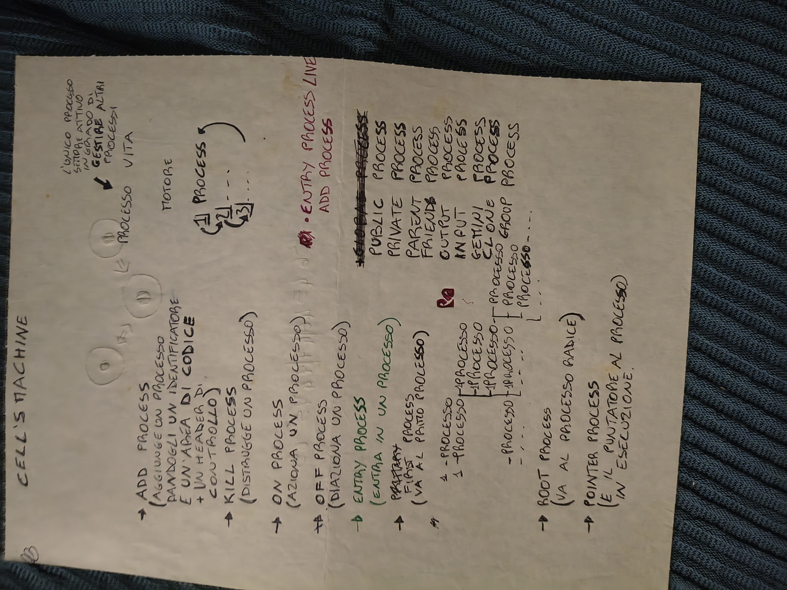

# Trascrizione — CELL'S MACHINE, comandi di processo

| | |
| --- | --- |
| Foto | [IMG_20261013_203650346_HDR.jpg](../IMG_20261013_203650346_HDR.jpg) |
| Scatto | 13 ottobre 2026 |
| Supporto | Foglio manoscritto. Titolo in alto. Comandi in nero, alcune righe in verde, un appunto in rosso. In alto a sinistra un «3» o una lettera isolata. |
| Ordine di lettura | Titolo e processo VITA, elenco comandi a sinistra, tipi a destra, albero in basso. |



Il verso di questo foglio, con numeri scritti sopra il testo che traspare, è [IMG_20261013_203656335_HDR.jpg](../IMG_20261013_203656335_HDR.jpg).

## Testo

CELL'S MACHINE

L’UNICO PROCESSO SEMPRE ATTIVO IN GRADO DI GESTIRE ALTRI PROCESSI: PROCESSO VITA

MOTORE

```
PROCESS
1 ...
2 ...
3 ...
```

-> ADD PROCESS
(AGGIUNGE UN PROCESSO DANDOGLI UN IDENTIFICATORE E UN’AREA DI CODICE + UN HEADER DI CONTROLLO)

-> KILL PROCESS
(DISTRUGGE UN PROCESSO)

-> ON PROCESS
(AZIONA UN PROCESSO)

-> OFF PROCESS
(DIAZIONA UN PROCESSO)

-> ENTRY PROCESS
(ENTRA IN UN PROCESSO)

-> FIRST PROCESS
(VA AL PRIMO PROCESSO)

-> ROOT PROCESS
(VA AL PROCESSO RADICE)

-> POINTER PROCESS
(È IL PUNTATORE AL PROCESSO IN ESECUZIONE.)

In rosso, a destra: ENTRY PROCESS LINE / ADD PROCESS

Elenco dei tipi, con GLOBAL PROCESS barrato:

```
PUBLIC PROCESS
PRIVATE PROCESS
PARENT PROCESS
FRIEND PROCESS
OUTPUT PROCESS
INPUT PROCESS
GETINI PROCESS
CLONE PROCESS
GROUP PROCESS
```

Albero di processi, senza nomi oltre la parola PROCESSO ripetuta. Un ramo è etichettato GROUP.

## Note di lettura

- «DIAZIONA» è scritto così per OFF PROCESS. Non è stato cambiato in «disattiva».
- FIRST PROCESS è riscritto sopra una parola precedente, forse PRIMARY. La parola finale leggibile è FIRST.
- GETINI è incerto. Può essere GETINI, GET IN o un’altra abbreviazione.
- PARENT e FRIEND sono letture stabili. FRIEND è al singolare.
- Le righe ENTRY e FIRST sono in verde. L’appunto ENTRY PROCESS LINE è in rosso.
