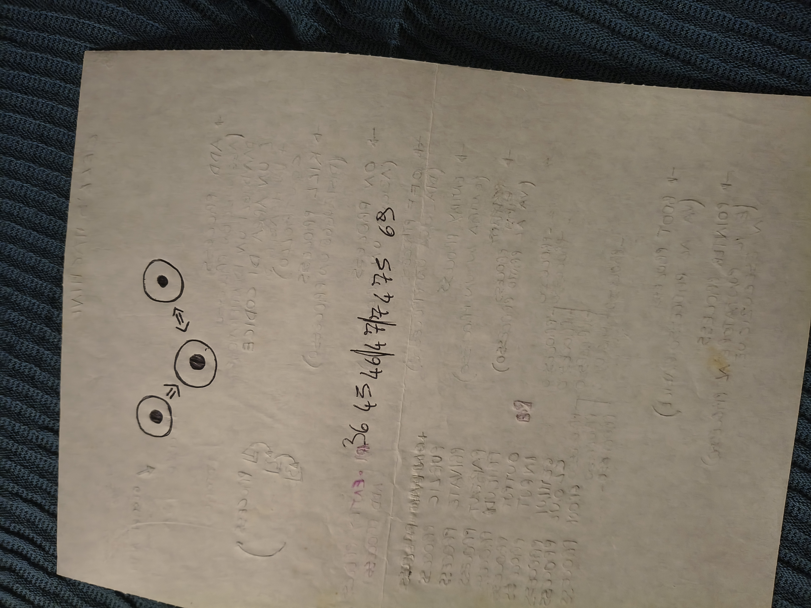

# Trascrizione — Verso di CELL'S MACHINE, con numeri

| | |
| --- | --- |
| Foto | [IMG_20261013_203656335_HDR.jpg](../IMG_20261013_203656335_HDR.jpg) |
| Scatto | 13 ottobre 2026 |
| Supporto | Verso del foglio [IMG_20261013_203650346_HDR.jpg](../IMG_20261013_203650346_HDR.jpg). Il testo della machine traspare rovesciato. Sopra sono scritti dei numeri. |
| Ordine di lettura | Solo i segni aggiunti su questo lato. Il testo rovesciato non viene ricopiato: è lo stesso della facciata. |



## Testo aggiunto su questo lato

In alto, tre cerchi collegati da frecce. Non hanno etichette.

Numeri scritti di traverso, in grande:

```
36 45 46 / 47 / 47 5 68
```

Più in basso, isolato: 89

Sul margine sinistro traspaiono, dal recto, colonne di numeri e parole già lette sull’altra facciata: PUBLIC, PRIVATE, PARENT, FRIEND, OUTPUT, INPUT. Non sono testo nuovo.

## Note di lettura

- I numeri possono essere un telefono o una sequenza di prova. Non c’è una didascalia.
- La barra fra 46 e 47 è sul foglio.
- «47 5» può essere «475». Lo spazio è visibile ed è stato tenuto.
