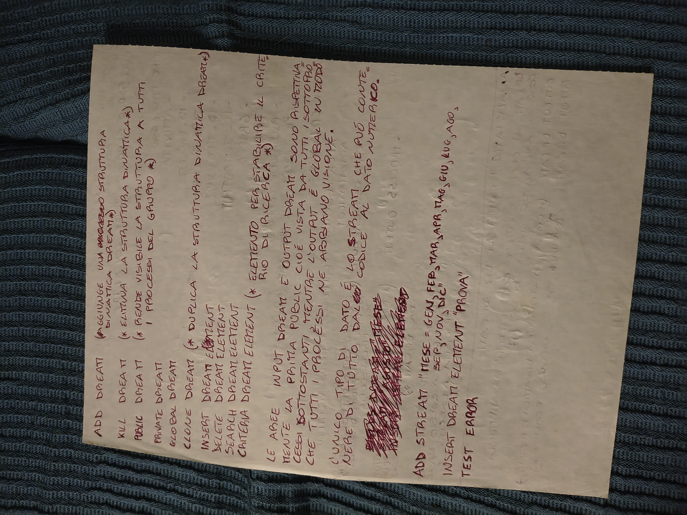

# Trascrizione — Comandi DREAM e STREAM

| | |
| --- | --- |
| Foto | [IMG_20261013_203711813_HDR.jpg](../IMG_20261013_203711813_HDR.jpg) |
| Scatto | 13 ottobre 2026 |
| Supporto | Foglio manoscritto in inchiostro scuro. In basso traspare altro testo dal verso. Un blocco centrale è cancellato. |
| Ordine di lettura | Elenco comandi, paragrafo sulle aree, esempio, riga TEST ERROR. |



## Testo

```
ADD DREAM        (AGGIUNGE UNA STRUTTURA DINAMICA DREAM)
KILL DREAM       (* ELIMINA LA STRUTTURA DINAMICA *)
PUBLIC DREAM     (* RENDE VISIBILE LA STRUTTURA A TUTTI I PROCESSI DEL GRUPPO *)
PRIVATE DREAM
GLOBAL DREAM
CLONE DREAM      (* DUPLICA LA STRUTTURA DINAMICA DREAM *)
INSERT DREAM ELEMENT
DELETE DREAM ELEMENT
SEARCH DREAM ELEMENT
CRITERIA DREAM ELEMENT  (* ELEMENTO PER STABILIRE IL CRITERIO DI RICERCA *)
```

LE AREE INPUT DREAM E OUTPUT DREAM SONO RISPETTIVAMENTE LA PRIMA PUBLIC CIOÈ VISTA DA TUTTI I SOTTOPROCESSI SOTTOSTANTI, MENTRE L’OUTPUT È GLOBAL IN MODO CHE TUTTI I PROCESSI NE ABBIANO VISIONE.

L’UNICO TIPO DI DATO È LO STREAM CHE PUÒ CONTENERE DI TUTTO DAL CODICE AL DATO NUMERICO.

Sotto questa frase c’è un blocco di quattro o cinque righe cancellato. Non si legge.

```
ADD STREAM "MESE = GEN, FEB, MAR, APR, MAG, GIU, LUG, AGO, SEP, NOV, DIC"
INSERT DREAM ELEMENT "PROVA"
TEST ERROR
```

## Note di lettura

- PRIVATE DREAM e GLOBAL DREAM non hanno la glossa fra parentesi.
- «SOTTOPROCESSI SOTTOSTANTI» è la lettura; le due parole si somigliano e una può essere una ripetizione.
- Nell’elenco dei mesi manca SET, e SEP sta dopo AGO insieme a NOV e DIC. È scritto così. OTT non compare.
- Il testo chiaro in fondo al foglio è il verso che traspare. Non è stato trascritto come testo di questa facciata.
