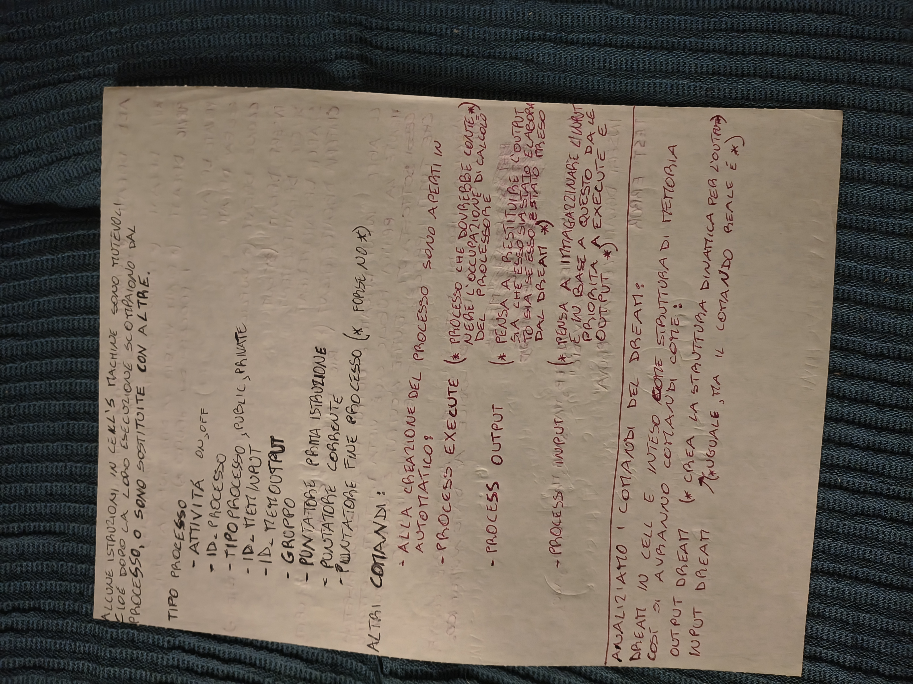

# Trascrizione — Istruzioni che scoppiano e comandi del dream

| | |
| --- | --- |
| Foto | [IMG_20261013_203717861_HDR.jpg](../IMG_20261013_203717861_HDR.jpg) |
| Scatto | 13 ottobre 2026 |
| Supporto | Foglio manoscritto. Il titolo e l’elenco TIPO PROCESSO sono in nero. ALTRI COMANDI e il paragrafo sul dream sono in rosso. Dal verso traspare altro testo. |
| Ordine di lettura | Dall’alto in basso. |



## Testo

ALCUNE ISTRUZIONI IN CELL'S MACHINE SONO MUTEVOLI CIOÈ DOPO LA LORO ESECUZIONE SCOPPIANO DAL PROCESSO, O SONO SOSTITUITE CON ALTRE.

TIPO PROCESSO

- ATTIVITÀ ON, OFF
- ID. PROCESSO
- TIPO PROCESSO, PUBLIC, PRIVATE
- ID. MEM INPUT
- ID. MEM OUTPUT
- GRUPPO
- PUNTATORE PRIMA ISTRUZIONE
- PUNTATORE CORRENTE
- PUNTATORE FINE PROCESSO (* FORSE NO *)

ALTRI COMANDI:

- ALLA CREAZIONE DEL PROCESSO SONO APERTI IN AUTOMATICO:
- PROCESS EXECUTE (* PROCESSO CHE DOVREBBE CONTENERE L’OCCUPAZIONE DI CALCOLO DEL PROCESSORE *)
- PROCESS OUTPUT (* PENSA A RESTITUIRE L’OUTPUT SIA CHE ESSO SIA STATO ELABORATO SIA SE ESSO È STATO PRESO DAL DREAM *)
- PROCESS INPUT (* PENSA A IMMAGAZZINARE L’INPUT E, IN BASE A QUESTO, DA LE PRIORITÀ A EXECUTE E OUTPUT *)

ANALIZZIAMO I COMANDI DEL DREAM:

DREAM IN CELL È INTESO COME STRUTTURA DI MEMORIA COSÌ DI AVRANNO COMANDI COME:

```
OUTPUT DREAM
INPUT DREAM   (* CREA LA STRUTTURA DINAMICA PER L’OUTPUT *)
              (* UGUALE, MA IL COMANDO REALE È *)
```

La glossa di INPUT DREAM resta sospesa: il nome del comando reale non è scritto sotto.

## Note di lettura

- «SCOPEPIANO» è la grafia del foglio per «scoppiano».
- «ID. MEM INPUT» e «ID. MEM OUTPUT»: MEM è più sicuro di ITEM. Una lettura alternativa è MEM/ITEM con le stesse quattro lettere poco staccate.
- «COSÌ DI AVRANNO» è scritto così.
- «DA LE PRIORITÀ» è scritto senza apostrofo.
- La riga «UGUALE, MA IL COMANDO REALE È» non ha seguito sul foglio.
