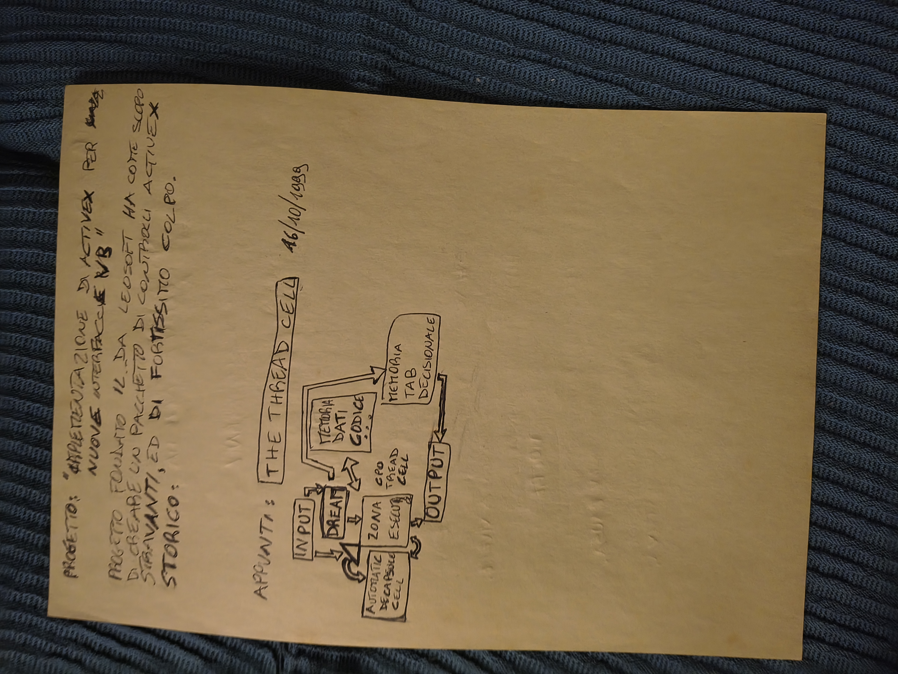

# Trascrizione — THE THREAD CELL, 16 ottobre

| | |
| --- | --- |
| Foto | [IMG_20261013_203730629_HDR.jpg](../IMG_20261013_203730629_HDR.jpg) |
| Scatto | 13 ottobre 2026 |
| Supporto | Foglio manoscritto. In alto il progetto LEOSOFT. Sotto, uno schema datato. I tre quarti inferiori del foglio sono vuoti. |
| Ordine di lettura | Intestazione, poi lo schema da sinistra a destra. |



## Testo

PROGETTO: "IMPLEMENTAZIONE DI ACTIVEX PER NUOVE INTERFACCE VB"

PROGETTO FONDATO IL DA LEOSOFT HA COME SCOPO DI CREARE UN PACCHETTO DI CONTROLLI ACTIVEX STIMOLANTI, ED DI FORTISSIMO COLPO.

STORICO:

APPUNTI: THE THREAD CELL          16/10/1998

Schema, riquadri collegati da frecce:

```
INPUT
  DREAM
  AUTOMATIC DECAPSULE CELL
  ZONA ESECUZ
  CPO THREAD CELL
        MEMORIA
        DATI
        CODICE
        ...
        MEMORIA
        TAB
        DECISIONALE
OUTPUT
```

INPUT entra in DREAM. DREAM scende verso ZONA ESECUZ e verso AUTOMATIC DECAPSULE CELL. ZONA ESECUZ e CPO THREAD CELL stanno al centro. Da lì una freccia sale a MEMORIA DATI CODICE e una scende a MEMORIA TAB DECISIONALE. OUTPUT è in basso e riceve una freccia dalla tabella decisionale.

## Note di lettura

- La data si legge 16/10/1998. L’ultima cifra è stretta: in una lettura precedente del progetto era stata vista come 1999. La foto resta la fonte; l’anno non è stato normalizzato.
- «FONDATO IL DA LEOSOFT» non ha il giorno dopo «IL».
- «CPO THREAD CELL» può essere «CPU THREAD CELL». Le lettere sono CPO nella lettura di questa foto.
- «ZONA ESECUZ» è troncato sul riquadro, senza «IONE».
- «ED DI FORTISSIMO COLPO» è lasciato com’è.
