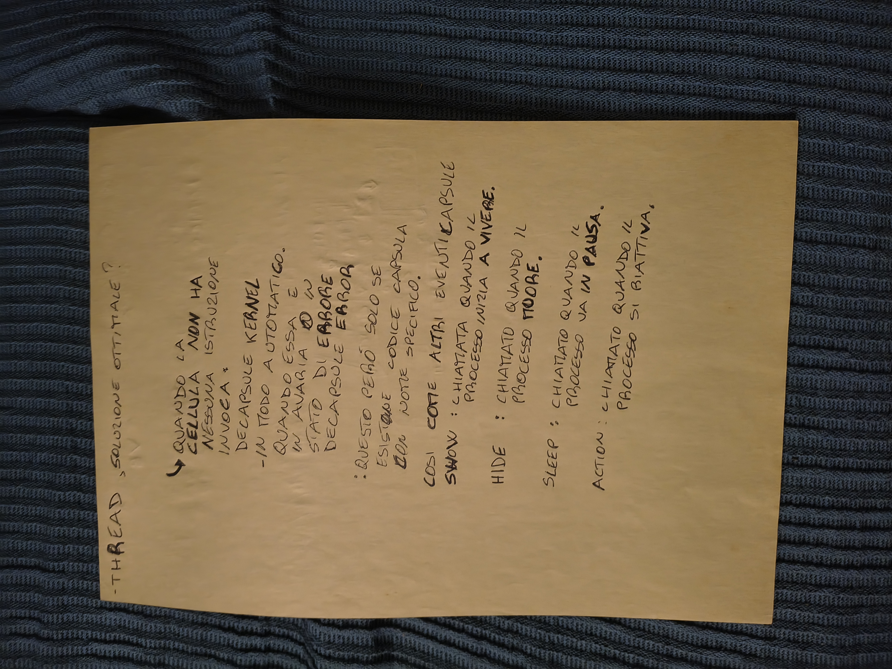

# Trascrizione — THREAD, soluzione ottimale?

| | |
| --- | --- |
| Foto | [IMG_20261013_203759627_HDR.jpg](../IMG_20261013_203759627_HDR.jpg) |
| Scatto | 13 ottobre 2026 |
| Supporto | Foglio manoscritto, solo la metà superiore è scritta. |
| Ordine di lettura | Titolo, due casi di decapsula, nota, quattro eventi. |



## Testo

THREAD, SOLUZIONE OTTIMALE?

QUANDO LA CELLULA NON HA NESSUNA ISTRUZIONE INVOCA DECAPSULE KERNEL
- IN MODO AUTOMATICO.

QUANDO ESSA È IN AVARIA O IN STATO DI ERRORE
DECAPSULE ERROR

QUESTO PERÒ SOLO SE ESISTE CODICE CAPSULA CON NOTE SPECIFICO.

COSÌ COME ALTRI EVENTI CAPSULE

```
SHOW   : CHIAMATA QUANDO IL PROCESSO INIZIA A VIVERE.
HIDE   : CHIAMATO QUANDO IL PROCESSO MUORE.
SLEEP  : CHIAMATO QUANDO IL PROCESSO VA IN PAUSA.
ACTION : CHIAMATO QUANDO IL PROCESSO SI RIATTIVA.
```

## Note di lettura

- La prima riga del titolo ha un trattino prima di THREAD.
- SHOW è stabile. Una sbavatura iniziale può far leggere SWOW; la parola nel foglio è SHOW.
- SHOW usa «CHIAMATA», gli altri tre «CHIAMATO».
- «CON NOTE SPECIFICO» è scritto così, senza accordo.
- «EVENTI CAPSULE» chiude la nota e introduce l’elenco.
