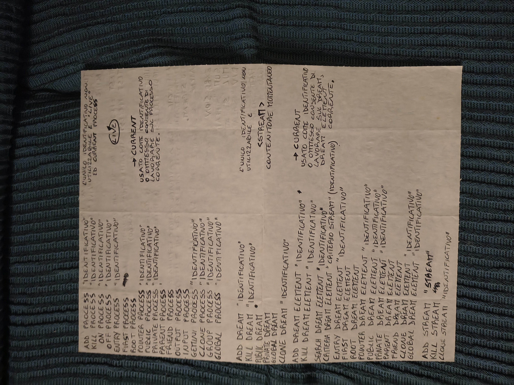

# Trascrizione — Elenco comandi PROCESS, DREAM, STREAM

| | |
| --- | --- |
| Foto | [IMG_20261013_203811244_HDR.jpg](../IMG_20261013_203811244_HDR.jpg) |
| Scatto | 13 ottobre 2026 |
| Supporto | Foglio piegato in due. A sinistra l’elenco dei comandi, a destra due note su LIVE e STREAM. Dal verso traspare altro testo. |
| Ordine di lettura | Colonna sinistra dall’alto, poi le due note a destra. |



## Testo — colonna sinistra

```
ADD PROCESS        "IDENTIFICATIVO"
KILL PROCESS       "IDENTIFICATIVO"
ON PROCESS         "IDENTIFICATIVO"
OFF PROCESS        "IDENTIFICATIVO"
ENTRY PROCESS      "IDENTIFICATIVO"
FIRST PROCESS
ROOT PROCESS
POINTER PROCESS    "IDENTIFICATIVO"
PUBLIC PROCESS     "IDENTIFICATIVO"
PRIVATE PROCESS    "IDENTIFICATIVO"
PARENT PROCESS
FRIEND PROCESS
OUTPUT PROCESS
INPUT PROCESS
GETINI PROCESS     "IDENTIFICATIVO"
CLONE PROCESS      "IDENTIFICATIVO"
GROUP PROCESS      "IDENTIFICATIVO"
GLOBAL PROCESS     "IDENTIFICATIVO"

ADD DREAM          "IDENTIFICATIVO"
KILL DREAM         "IDENTIFICATIVO"
PUBLIC DREAM
PRIVATE DREAM
GLOBAL DREAM
CLONE DREAM        "IDENTIFICATIVO"

ADD DREAM ELEMENT     "IDENTIFICATIVO"
KILL DREAM ELEMENT    "IDENTIFICATIVO"
SEARCH DREAM ELEMENT  "IDENTIFICATIVO"
CRITERIA DREAM ELEMENT "CRITERIO STREAM" (IDENTIFICATIVO)
ENTRY DREAM ELEMENT   "IDENTIFICATIVO"
FIRST DREAM ELEMENT
ROOT DREAM ELEMENT
POINTER DREAM ELEMENT "IDENTIFICATIVO"
PUBLIC DREAM ELEMENT  "IDENTIFICATIVO"
PRIVATE DREAM ELEMENT "IDENTIFICATIVO"
PARENT DREAM ELEMENT
FRIEND DREAM ELEMENT
CLONE DREAM ELEMENT   "IDENTIFICATIVO"
GLOBAL DREAM ELEMENT  "IDENTIFICATIVO"

ADD STREAM         "STREAM"
KILL STREAM
CLOSE STREAM       "IDENTIFICATIVO"
```

FIRST PROCESS ha un segno o una freccia al posto dell’argomento. KILL STREAM ha un segno non leggibile al posto dell’argomento.

## Testo — colonna destra

L’UNICO IDENTIFICATIVO NON UTILIZZABILE È "LIVE" ED CURRENT PROCESS

LIVE, cerchiato.

-> CURRENT
USATO COME IDENTIFICATIVO O OMESSO CONSENTE DI LAVORARE SUL PROCESSO CORRENTE.

L’UNICO IDENTIFICATIVO NON UTILIZZABILE È

<STREAM>
CONTENITORE MOLTEPLICATO

-> CURRENT
USATO COME IDENTIFICATIVO O OMESSO CONSENTE DI LAVORARE SUL DREAM, DREAM ELEMENT CORRENTE.

## Note di lettura

- GETINI resta incerto, come nel foglio CELL'S MACHINE.
- «ED CURRENT PROCESS» è scritto così, senza «E IL».
- «CONTENITORE MOLTEPLICATO» è la lettura di <STREAM>. Una lettera centrale è stretta.
- PARENT, FRIEND, OUTPUT, INPUT, FIRST, ROOT e PRIVATE/GLOBAL DREAM non hanno l’argomento "IDENTIFICATIVO" sulla riga.
- Il testo chiaro che traspare non è di questa facciata.
