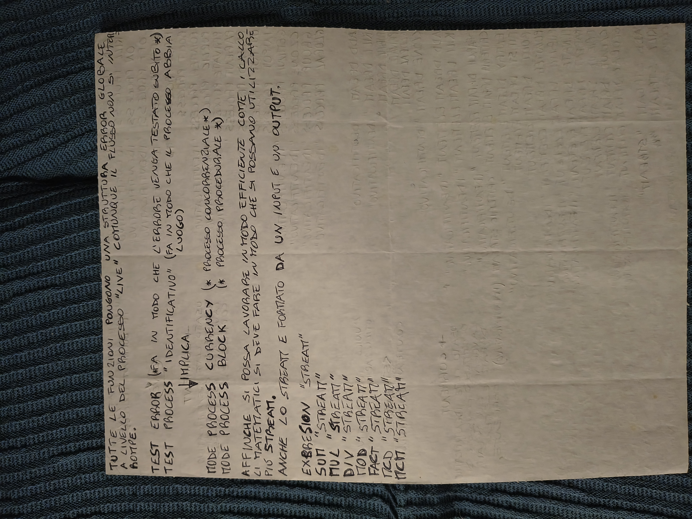

# Trascrizione — TEST ERROR, modi del processo, espressioni

| | |
| --- | --- |
| Foto | [IMG_20261013_203817491_HDR.jpg](../IMG_20261013_203817491_HDR.jpg) |
| Scatto | 13 ottobre 2026 |
| Supporto | Metà superiore scritta. La metà inferiore è il verso che traspare, lo stesso elenco comandi del foglio precedente. |
| Ordine di lettura | Dall’alto. Le righe chiare in basso non sono testo di questa facciata. |



## Testo

TUTTE LE FUNZIONI PONGONO UNA STRUTTURA ERROR GLOBALE A LIVELLO DEL PROCESSO "LIVE" COMUNQUE IL FLUSSO NON SI INTERROMPE.

```
TEST ERROR
TEST PROCESS "IDENTIFICATIVO"  (FA IN MODO CHE L'ERRORE VENGA TESTATO SUBITO)
                                (FA IN MODO CHE IL PROCESSO ABBIA LUOGO)
```

IMPLICA

```
MODE PROCESS CURRENCY   (* PROCESSO CONCORRENZIALE *)
MODE PROCESS BLOCK      (* PROCESSO PROCEDURALE *)
```

AFFINCHÉ SI POSSA LAVORARE IN MODO EFFICIENTE CON I CALCOLI MATEMATICI SI DEVE FARE IN MODO CHE SI POSSANO UTILIZZARE PIÙ STREAM.

ANCHE LO STREAM È FORMATO DA UN INPUT E UN OUTPUT.

```
EXSPRESION "STREAM"
SUM  "STREAM"
MUL  "STREAM"
DIV  "STREAM"
MOD  "STREAM"
FACT "STREAM"
RED  "STREAM"
MEM  "STREAM"
```

## Note di lettura

- «COMUNQUE IL FLUSSO NON SI INTERROMPE» è tutto di seguito, senza punteggiatura fra LIVE e COMUNQUE.
- CURRENCY è la grafia del foglio. La glossa dice CONCORRENZIALE.
- EXSPRESION è scritto così.
- FACT, RED e MEM non sono sciolti sul foglio. Non è stato imposto un significato.
- La freccia sotto TEST PROCESS indica che i due MODE sono ciò che «IMPLICA».
