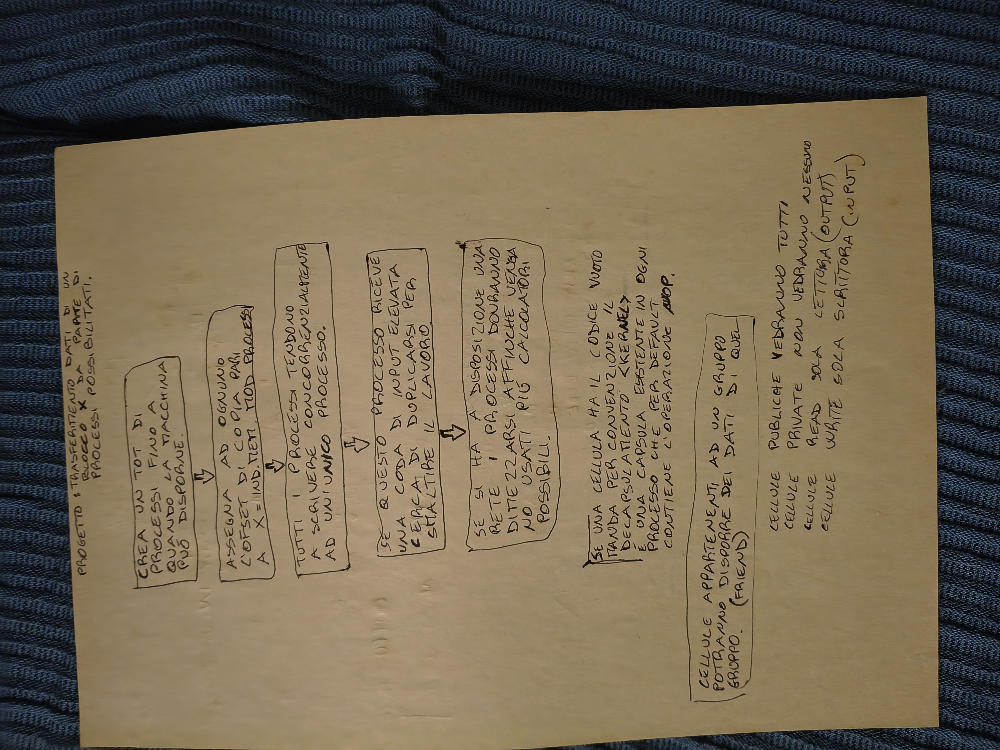

# Trascrizione — Trasferimento di un blocco e visibilità delle cellule

| | |
| --- | --- |
| Foto | [IMG_20261013_203828526_HDR.jpg](../IMG_20261013_203828526_HDR.jpg) |
| Scatto | 13 ottobre 2026 |
| Supporto | Foglio manoscritto a riquadri collegati da frecce, poi due note in basso. |
| Ordine di lettura | Titolo, cinque riquadri dall’alto, nota sul kernel, nota sul gruppo, quattro righe di visibilità. |



## Testo

PROGETTO: TRASFERIMENTO DATI DI UN BLOCCO X DA PARTE DI PROCESSI POSSIBILITATI.

CREA UN TOT DI PROCESSI FINO A QUANDO LA MACCHINA PUÒ DISPORRE.

ASSEGNA AD OGNUNO L’OFFSET DI COPIA PARI A X = MOD.TETTI MOD PROCESS

TUTTI I PROCESSI TENDONO A SCRIVERE CONCORRENZIALMENTE AD UN UNICO PROCESSO.

SE QUESTO PROCESSO RICEVE UNA CODA DI INPUT ELEVATA CERCA DI DUPLICARSI PER STALZARE IL LAVORO.

SE SI HA A DISPOSIZIONE UNA RETE I PROCESSI DOVRANNO DITEZZARSI AFFINCHÉ VENGA NO USATI PIÙ CALCOLATORI POSSIBILI.

SE UNA CELLULA HA IL CODICE VUOTO MANDA PER CONVENZIONE IL DECAPSULAMENTO <KERNEL> È UNA CAPSULA ESISTENTE IN OGNI PROCESSO CHE PER DEFAULT CONTIENE L’OPERAZIONE NOP.

CELLULE APPARTENENTI AD UN GRUPPO POTRANNO DISPORRE DEI DATI DI QUEL GRUPPO. (FRIEND)

```
CELLULE PUBLICHE VEDRANNO TUTTI
CELLULE PRIVATE  NON VEDRANNO NESSUNO
CELLULE READ     SOLA LETTURA (OUTPUT)
CELLULE WRITE    SOLA SCRITTURA (INPUT)
```

## Note di lettura

- «PROCESSI POSSIBILITATI» è scritto così.
- «MOD.TETTI MOD PROCESS» è incerto nella parola TETTI. Può essere TETTI o TESTI.
- «STALZARE» è la lettura. Non è stato cambiato in «spalmare» o «smaltire».
- «DITEZZARSI» e «VENGA NO USATI» sono lasciati come scritti. La seconda può essere «VENGANO USATI» con le lettere attaccate.
- «CODICE VUOTO» è più stabile di una lettura «NUOTO»: la V iniziale si vede.
- PUBLICHE è scritto con la H.
