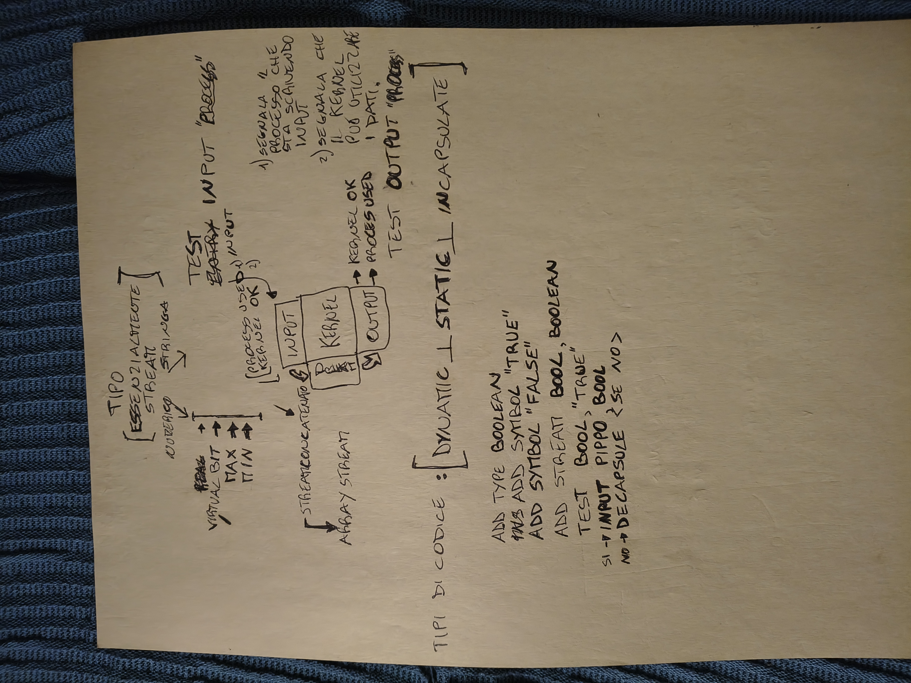

# Trascrizione — Tipo, kernel e codice dinamico o statico

| | |
| --- | --- |
| Foto | [IMG_20261013_203834058_HDR.jpg](../IMG_20261013_203834058_HDR.jpg) |
| Scatto | 13 ottobre 2026 |
| Supporto | Schema in alto e un esempio di programma in basso. |
| Ordine di lettura | Schema del tipo, poi TIPI DI CODICE, poi l’esempio. |



## Testo — schema

```
TIPO
[ ESSENZIALMENTE STREAM ]
    NUMERICO          STRINGA
```

Dal ramo numerico:

```
REAL
VIRTUAL BIT
MAX
MIN
```

entrano in un INPUT. A sinistra: STREAM CONCATENATO e ARRAY STREAM.

Al centro, tre riquadri:

```
INPUT
PATH   KERNEL
OUTPUT
```

A destra:

```
TEST INPUT "PROCESS"
(PROCESS USED)
(REQ. DEL OK)
```

1) SEGNALA IL PROCESSO CHE STA SCANENDO INPUT

2) SEGNALA CHE IL KERNEL PUÒ UTILIZZARE I DATI.

```
REQ. DEL OK
PROCESS USED
TEST OUTPUT "PROCESS"
```

## Testo — tipi di codice

TIPI DI CODICE : [ DYNAMIC | STATIC | INCAPSULATE ]

## Testo — esempio

```
ADD TYPE BOOLEAN
1^ ADD SYMBOL "TRUE"
ADD SYMBOL "FALSE"
ADD STREAM BOOL, BOOLEAN
TEST BOOL, "TRUE"
SI -> INPUT PIPPO, BOOL
NO -> DECAPSULE <SE NO>
```

## Note di lettura

- «ESSENZIALMENTE» è scritto in lettere strette dentro la parentesi quadra. La lettura è stabile nel senso, meno nella grafia.
- «SCANENDO» è senza la I di «scansionando»? Sul foglio si legge SCANENDO. È lasciato così.
- «REQ. DEL OK» torna due volte. DEL può essere DELL’.
- «1^» prima di ADD SYMBOL è un segno di primo passo, non una parola.
- INCAPSULATE è in inglese nel foglio, accanto a DYNAMIC e STATIC.
- PATH è l’etichetta a sinistra del riquadro KERNEL.
