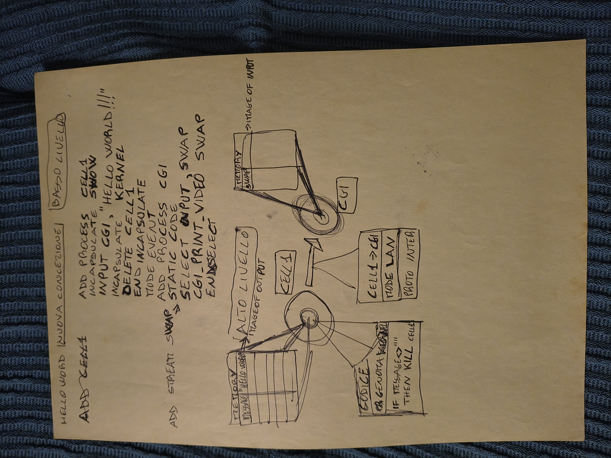

# Trascrizione — Hello word, basso livello e genotipo

| | |
| --- | --- |
| Foto | [IMG_20261013_203856001_HDR.jpg](../IMG_20261013_203856001_HDR.jpg) |
| Scatto | 13 ottobre 2026 |
| Supporto | Foglio manoscritto. In alto un programma, in basso uno schema con due dischi. |
| Ordine di lettura | Titolo e codice, poi lo schema da sinistra a destra. |



## Testo — programma

HELLO WORD (NUOVA CONCEZIONE)    BASSO LIVELLO

ADD CELL è scritto e barrato.

```
ADD PROCESS CELL1
INCAPSULATE SHOW
INPUT CGI, "HELLO WORLD!!!"
INCAPSULATE KERNEL
DELETE CELL1
END INCAPSULATE
MODE EVENT
ADD STREAM SWAP
ADD PROCESS CGI
STATIC CODE
SELECT INPUT, SWAP
CGI_PRINT_VIDEO SWAP
END SELECT
```

ADD STREAM SWAP sta a sinistra, con una freccia verso STATIC CODE.

## Testo — schema

A sinistra un riquadro MEMORY con la riga MESSAGE "HELLO WORD". È etichettato ALTO LIVELLO, IMAGE OF OUTPUT, e punta a un disco CELL'S.

A destra un riquadro MEMORY SWAP, con la nota IMAGE OF INPUT, punta a un disco CGI.

Sotto CELL'S:

```
CODICE
OR GENOTIPO
IF MESSAGE <> ""
THEN KILL CELL
```

Tra i due dischi:

```
CELL1 -> CGI
MODE LAN
PROTO INTER
```

## Note di lettura

- Il titolo è WORD, non WORLD. Nel codice la stringa è "HELLO WORLD!!!".
- SHOW è scritto sopra INCAPSULATE, come nome della capsula.
- «OR GENOTIPO» è la lettura della riga sotto CODICE. Una parola accanto è barrata e non si legge.
- MODE LAN e PROTO INTER sono nel riquadro centrale, non nel listato in alto.
- I due dischi sono disegnati, non descritti da una frase.
