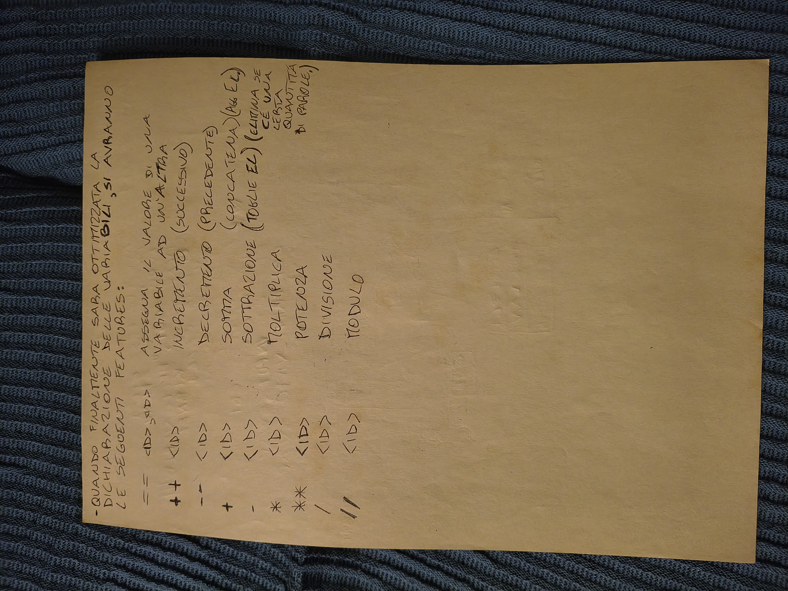

# Trascrizione — Operatori, quando le variabili saranno ottimizzate

| | |
| --- | --- |
| Foto | [IMG_20261013_203900712_HDR.jpg](../IMG_20261013_203900712_HDR.jpg) |
| Scatto | 13 ottobre 2026 |
| Supporto | Foglio manoscritto, solo la fascia alta è scritta. |
| Ordine di lettura | Titolo, poi la tabella dall’alto. |



## Testo

QUANDO FINALMENTE SARÀ OTTIMIZZATA LA DICHIARAZIONE DELLE VARIABILI, SI AVRANNO LE SEGUENTI FEATURES:

```
==   <ID>, <ID>   ASSEGNA IL VALORE DI UNA VARIABILE AD UN'ALTRA
++   <ID>         INCREMENTO (SUCCESSIVO)
--   <ID>         DECREMENTO (PRECEDENTE)
+    <ID>         SOMMA (CONCATENA) (ADD EL)
-    <ID>         SOTTRAZIONE (TOGLIE EL) (ELIMINA SE C'È UNA LETTERA QUATTRO DI PAROLE.)
*    <ID>         MOLTIPLICA
**   <ID>         POTENZA
/    <ID>         DIVISIONE
//   <ID>         MODULO
```

## Note di lettura

- «FEATURES» è in inglese, come sul foglio.
- La glossa di «-» è la più incerta: «(ELIMINA SE C'È UNA LETTERA QUATTRO DI PAROLE.)». Le parole si leggono così e non sono state corrette.
- «TOGLIE EL» sta accanto a SOTTRAZIONE, «ADD EL» accanto a SOMMA.
- Il resto del foglio è bianco.
