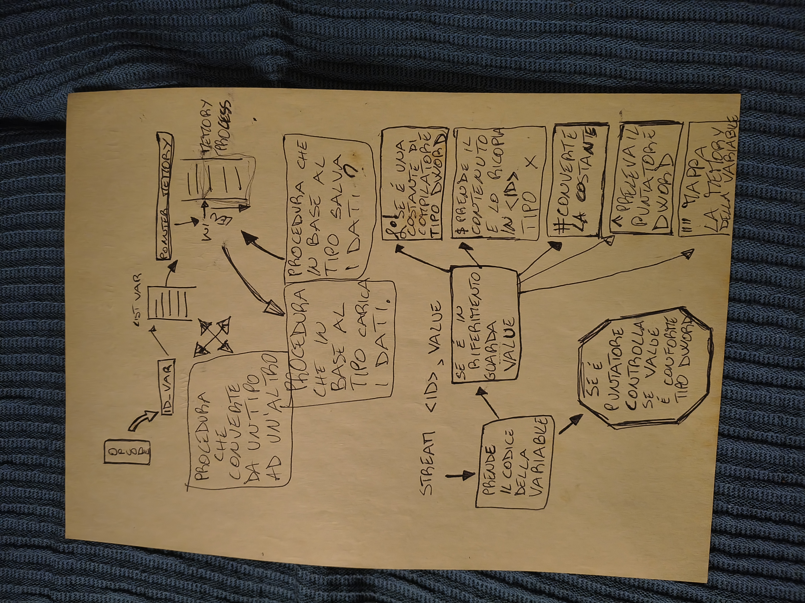

# Trascrizione — Conversione di tipo, stream e memoria

| | |
| --- | --- |
| Foto | [IMG_20261013_203911404_HDR.jpg](../IMG_20261013_203911404_HDR.jpg) |
| Scatto | 13 ottobre 2026 |
| Supporto | Schema a riquadri, senza un titolo. |
| Ordine di lettura | Dall’alto: identificatore e memoria, poi le procedure, poi STREAM e i casi a destra. |



## Testo

In alto un piccolo riquadro, lettura incerta, forse OFFSET, con una freccia verso ID-VAR.

ID-VAR punta a un elenco LIST VAR e a POINTER MEMORY. Accanto, un foglio etichettato MEMORY PROCESS, con un WI o un segno simile.

Tre procedure:

- PROCEDURA CHE CONVERTE DA UN TIPO AD UN'ALTRO
- PROCEDURA CHE IN BASE AL TIPO CARICA I DATI.
- PROCEDURA CHE IN BASE AL TIPO SALVA I DATI.

```
STREAM <ID>, VALUE
```

- PRENDE IL CODICE DELLA VARIABILE
- SE È IN RIFERIMENTO GUARDA VALUE
- SE È PUNTATORE CONTROLLA SE VALUE È CONFORME TIPO DWORD

A destra, casi:

```
$0 SE È UNA COSTANTE DI COMPILATORE TIPO DWORD
$  PRENDE IL CONTENUTO E LO RICOPIA IN <ID> TIPO X
#  CONVERTE LA COSTANTE
^  PRELEVA IL PUNTATORE DWORD
"  MAPPA LA MEMORY DELLA VARIABILE
```

## Note di lettura

- «AD UN'ALTRO» è scritto con l’apostrofo.
- «LIST VAR» è la lettura del foglietto in alto. Può essere «LST VAR».
- «WI» sul foglio MEMORY PROCESS non è una parola completa.
- I prefissi $, #, ^ e " sono sul foglio, allineati ai cinque casi.
- «COSTANTE DI COMPILATORE» è lasciato così, non «di compilazione».
