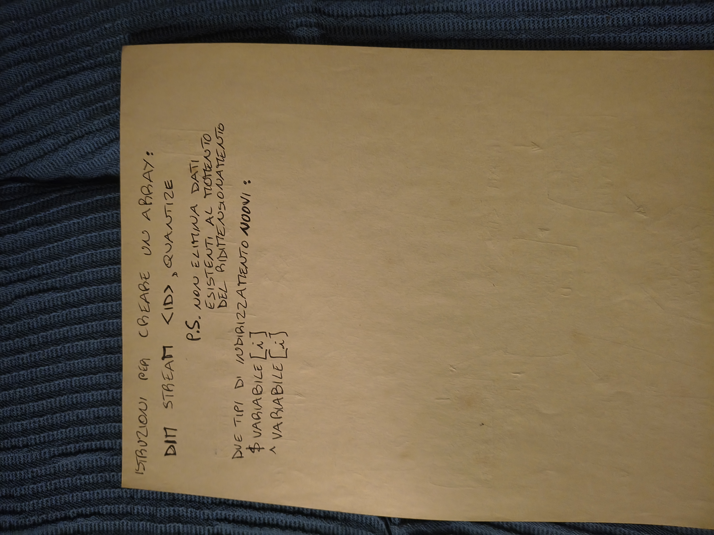

# Trascrizione — Istruzioni per creare un array

| | |
| --- | --- |
| Foto | [IMG_20261013_203917654_HDR.jpg](../IMG_20261013_203917654_HDR.jpg) |
| Scatto | 13 ottobre 2026 |
| Supporto | Foglio manoscritto, solo le prime righe. Il resto è vuoto, con qualche segno leggero che traspare. |
| Ordine di lettura | Dall’alto. |



## Testo

ISTRUZIONI PER CREARE UN ARRAY:

```
DIM STREAM <ID>, QUANTIZE
```

P.S. NON ELIMINA DATI ESISTENTI AL MOMENTO DEL RIDIMENSIONAMENTO

DUE TIPI DI INDIRIZZAMENTO NUOVI:

```
$ VARIABILE[i]
^ VARIABILE[i]
```

## Note di lettura

- QUANTIZE è scritto così, in inglese.
- «NUOVI» è sottolineato.
- I due prefissi sono il dollaro e il cappuccio, gli stessi segni del foglio sulla conversione di tipo.
- Non ci sono altre righe di programma su questa facciata.
