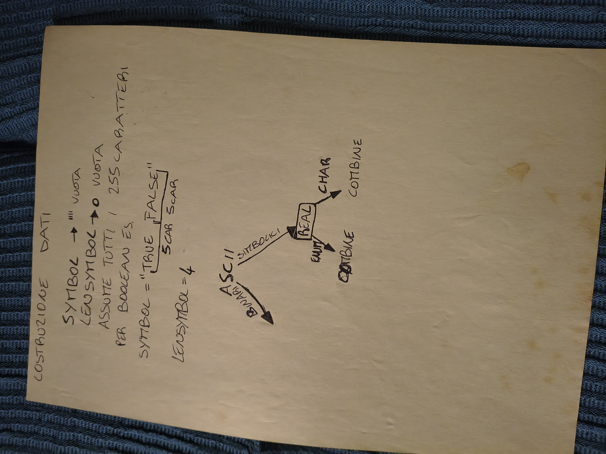

# Trascrizione — Costruzione dati, symbol e ASCII

| | |
| --- | --- |
| Foto | [IMG_20261013_203927428_HDR.jpg](../IMG_20261013_203927428_HDR.jpg) |
| Scatto | 13 ottobre 2026 |
| Supporto | Foglio manoscritto. Definizioni in alto, schema in mezzo. Il resto è vuoto. |
| Ordine di lettura | Titolo, definizioni, esempio BOOLEAN, schema. |



## Testo

COSTRUZIONE DATI

```
SYMBOL    -> ""  VUOTA
LENSYMBOL -> 0   VUOTA
```

ASSUME TUTTI I 255 CARATTERI

PER BOOLEAN ES.

```
SYMBOL = "TRUE FALSE"
```

Sotto TRUE è scritto 5 CAR. Sotto FALSE è scritto 5 CAR.

```
LENSYMBOL = 4
```

Schema:

ASCII sta in alto. Due frecce scendono: a sinistra BINARY, a destra SYMBOLICI. Entrambe arrivano a un riquadro REAL.

Da REAL partono due frecce: a sinistra ENUM, a destra CHAR. Sotto, due volte la parola COMBINE, una per ramo. La prima è in parte corretta e si legge COMBINE.

## Note di lettura

- TRUE ha quattro lettere e FALSE cinque. Il foglio segna 5 CAR sotto entrambe, e sotto LENSYMBOL = 4. I numeri non sono stati riallineati.
- «ASSUME» non ha il soggetto.
- BINARY è scritto in diagonale sulla freccia sinistra.
- Il secondo COMBINE, sotto CHAR, è più chiaro del primo.
