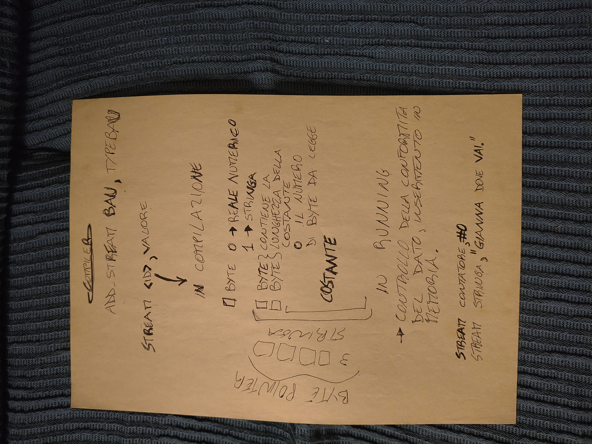

# Trascrizione — Compilazione dello stream e running

| | |
| --- | --- |
| Foto | [IMG_20261013_203942239_HDR.jpg](../IMG_20261013_203942239_HDR.jpg) |
| Scatto | 13 ottobre 2026 |
| Supporto | Foglio manoscritto. In alto una riga barrata, poi lo schema dei byte, poi due esempi. |
| Ordine di lettura | Dall’alto in basso. |



## Testo

COMPILER è sottolineato e barrato.

Anche la riga sotto è barrata:

```
ADD STREAM BAU, TYPEBAU
```

```
STREAM <ID>, VALORE
```

IN COMPILAZIONE

```
BYTE 0 -> REALE NUMERICO
       1 -> STRINGA
BYTE2 CONTIENE LA
BYTE3 LUNGHEZZA DELLA COSTANTE
      O IL NUMERO DI BYTE DA LEGGERE
COSTANTE
```

A sinistra un disegno etichettato BYTE POINTER: quattro quadretti, il terzo marcato 3, e la parola STRINGA lungo il bordo.

IN RUNNING

-> CONTROLLO DELLA CONFORMITÀ DEL DATO, INSERIMENTO IN MEMORIA.

```
STREAM CONTATORE, #0
STREAM STRINGA, "GIANNA DOVE VAI."
```

## Note di lettura

- BAU e TYPEBAU sono il testo barrato. Non è stato indovinato un nome sotto la cancellatura.
- BYTE2 e BYTE3 sono scritti uno sotto l’altro e condividono la frase sulla lunghezza.
- «REALE NUMERICO» è il valore 0. «STRINGA» è il valore 1.
- L’esempio finale usa la virgola prima della stringa, come le altre assegnazioni STREAM <ID>, VALORE.
