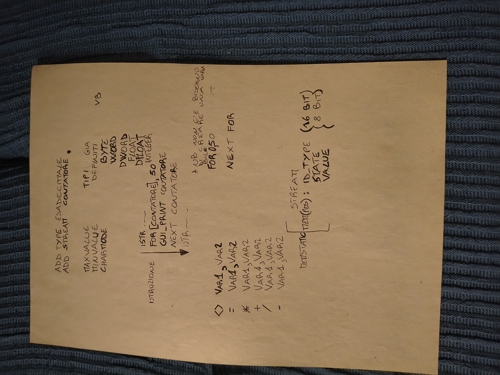

# Trascrizione — Tipo esadecimale, FOR e metastate

| | |
| --- | --- |
| Foto | [IMG_20261013_203946503_HDR.jpg](../IMG_20261013_203946503_HDR.jpg) |
| Scatto | 13 ottobre 2026 |
| Supporto | Foglio manoscritto con un programma, una lista di tipi e una tabella di operatori. |
| Ordine di lettura | Dall’alto: dichiarazioni, tipi, istruzione, operatori, struttura in basso. |



## Testo

```
ADD TYPE ESADECIMALE
ADD STREAM CONTATORE,
```

```
MAXVALUE
MINVALUE
CHARMODE
```

TIPI GIA DEFINITI

```
BYTE
WORD
DWORD
FLOAT
DFLOAT
INTEGER
```

A destra, isolato: VB

ISTRUZIONE

```
ISTR ---
FOR [CONTATORE], 50
GUI_PRINT CONTATORE
NEXT CONTATORE
ISTR ---
```

A destra, nota:

```
* VB NON C'È BISOGNO DI CREARE UNA VARIA
FOR 0,50
NEXT FOR
```

```
<>  VAR1, VAR2
=   VAR1, VAR2
*   VAR1, VAR2
+   VAR1, VAR2
/   VAR1, VAR2
-   VAR1, VAR2
```

```
METASTATE
ITEM(POS) :  ID_TYPE    (16 BIT)
             STATE      (8 BIT)
             VALUE
STREAM
```

## Note di lettura

- «VARIA» in chiusura della nota VB è troncato. Non è stato completato in «VARIABILE».
- INTEGER è scritto con una grafia che può leggersi anche WTEGER. La lettura tenuta è INTEGER.
- DFLOAT sta sotto FLOAT.
- METASTATE è la parola a sinistra della graffa. ITEM(POS) è dentro.
- CHARMODE può essere CHAR MODE su due righe attaccate. Sul foglio è una riga sola.
