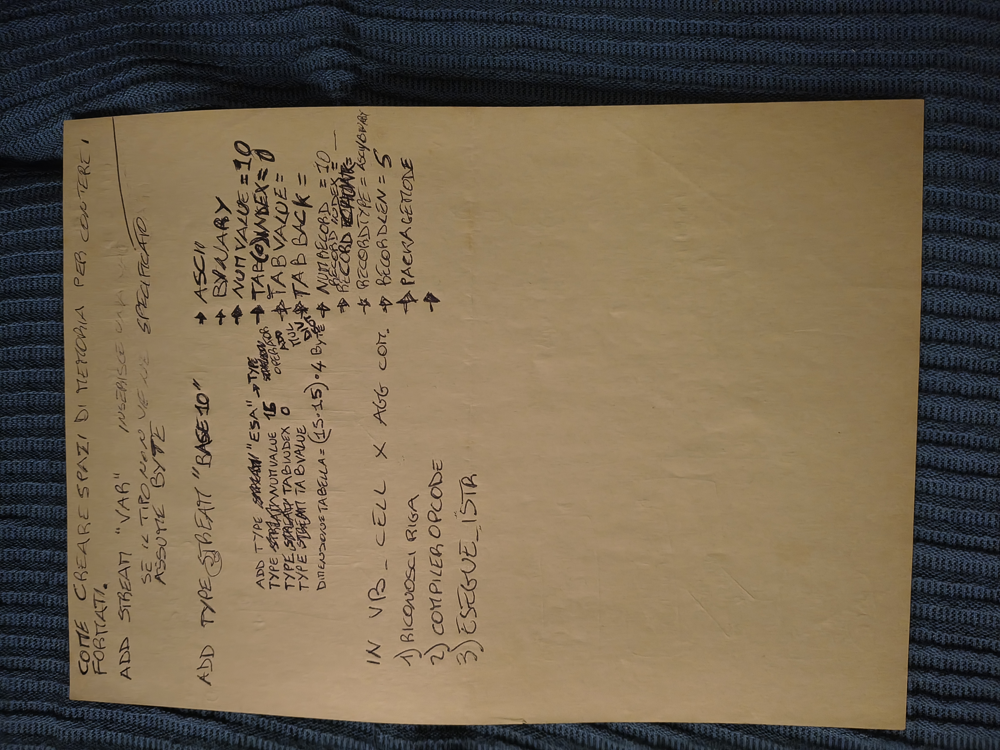

# Trascrizione — Spazi di memoria e tipo BASE10

| | |
| --- | --- |
| Foto | [IMG_20261013_203954797_HDR.jpg](../IMG_20261013_203954797_HDR.jpg) |
| Scatto | 13 ottobre 2026 |
| Supporto | Foglio manoscritto. Il centro è un blocco corretto e in parte illeggibile. A sinistra tre passi, a destra un elenco di campi. |
| Ordine di lettura | Titolo, ADD STREAM, ADD TYPE, poi la colonna destra e i tre passi. Il blocco centrale è trascritto solo nelle parole ancora visibili. |



## Testo

COME CREARE SPAZI DI MEMORIA PER CONTENERE I FORMATI.

```
ADD STREAM "VAR"
```

INSERISCE UNA [parola coperta]

SE IL TIPO NON VIENE SPECIFICATO ASSUME BYTE

```
ADD TYPE STREAM "BASE10"
```

A destra di BASE10:

```
-> ASCII
-> BINARY
-> NUM VALUE = 10
-> TAB COMPLEX = 0
-> TAB VALUE =
-> TAB BACK =
```

Blocco centrale, in parte cancellato. Si leggono ancora:

```
ADD TYPE STREAM "ESA" -> TYPE
TYPE STREAM NUMVALUE 16
TYPE STREAM TABINDEX 0
TYPE STREAM TA BVALUE
DIMENSIONE TABELLA = (15,15) * 4 BYTE
```

Le parole CREATOR, MUL e altre glosse in mezzo al blocco sono coperte. Non sono state ricostruite.

Colonna destra, sotto i campi:

```
NUM RECORD = 10
RECORD INDEX =
RECORD ROWNR
RECORDTYPE = ASCII/BINARY
RECORDLEN = 5
PACKAGEZIONE
```

```
IN VB - CELL X AGG COT.

1) RICONOSCI RIGA
2) COMPILER, OPCODE
3) ESEGUE_ISTR
```

## Note di lettura

- «FORMATI» è la lettura del titolo. La prima lettera è larga e può sembrare una P.
- «TAB COMPLEX» è incerto: le lettere centrali sono corrette. Può essere TAB INDEX scritto due volte in due righe diverse.
- «PACKAGEZIONE» è scritto così.
- «X AGG COT.» non è sciolto. Resta l’abbreviazione del foglio.
- Il blocco ESA è la zona meno affidabile della foto.
