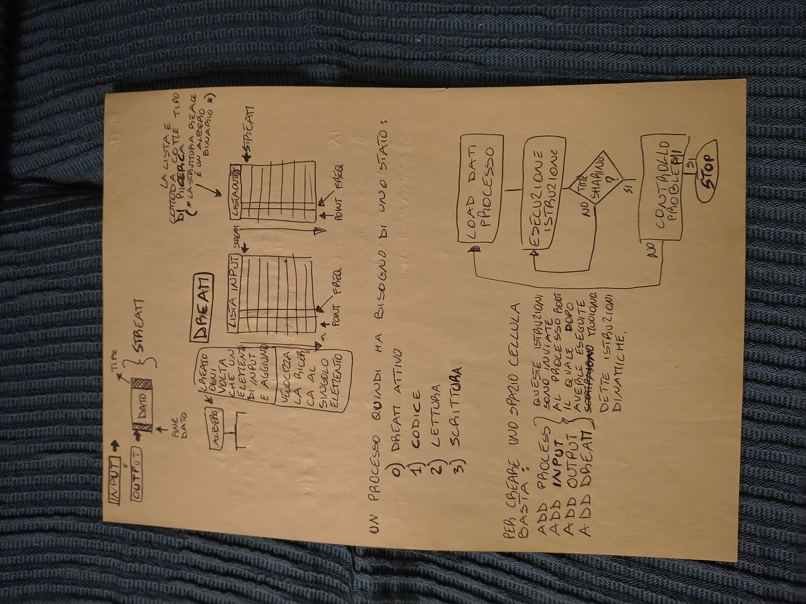

# Trascrizione — Dream, liste e time sharing

| | |
| --- | --- |
| Foto | [IMG_20261013_204000266_HDR.jpg](../IMG_20261013_204000266_HDR.jpg) |
| Scatto | 13 ottobre 2026 |
| Supporto | Schema in alto, elenco degli stati, programma e diagramma di flusso in basso. |
| Ordine di lettura | Input e dream, stati, creazione della cellula, flusso a destra. |



## Testo — schema

INPUT e OUTPUT entrano in un riquadro DATO. Una freccia sale: FINE DATO. A destra: TIPO STREAM.

DREAM contiene due tabelle:

```
LISTA INPUT          LISTA OUTPUT
STREAM               STREAM
POINT FREQ           POINT FREQ
```

Nota a sinistra della prima tabella:

CREATO OGNI VOLTA CHE UN ELEMENTO DI INPUT È AGGIUNTO VELOCIZZA LA RICERCA AL SINGOLO ELEMENTO

Nota sopra la seconda:

LA LISTA È COSTRUITA COME TIPO DI RICERCA (* LA STRUTTURA REALE È UN ALBERO DINAMICO *)

## Testo — stati

UN PROCESSO QUINDI HA BISOGNO DI UNO STATO:

```
0) DREAM ATTIVO
1) CODICE
2) LETTURA
3) SCRITTURA
```

## Testo — creazione

PER CREARE UNO SPAZIO CELLULA BASTA:

```
ADD PROCESS
ADD INPUT
ADD OUTPUT
ADD DREAM
```

QUESTE ISTRUZIONI SONO INVIATE AL PROCESSO ROOT IL QUALE DOPO AVERLE ESEGUITE SOSTITUISCE CON DELLE ISTRUZIONI DINAMICHE.

L’ultima frase è fitta: «SOSTITUISCE» è stabile, le due parole prima di «ISTRUZIONI DINAMICHE» sono meno nette. Si leggono come «CON DELLE».

## Testo — flusso

```
LOAD DATI PROCESSO
    |
ESECUZIONE ISTRUZIONE
    |
TIME SHARING ?
    NO -> torna a LOAD DATI PROCESSO
    SI
    |
CONTROLLO PROBLEMI
    NO -> torna a ESECUZIONE ISTRUZIONE
    SI
    |
STOP
```

## Note di lettura

- LISTA INPUT e LISTA OUTPUT sono intestazioni di griglie disegnate, non tabelle compilate.
- POINT FREQ sta sotto ciascuna griglia.
- «SINGOLO» nella nota sulla ricerca è più sicuro di «SVUOLO».
- Il rombo è etichettato TIME SHARING, con SI e NO sui due rami.
