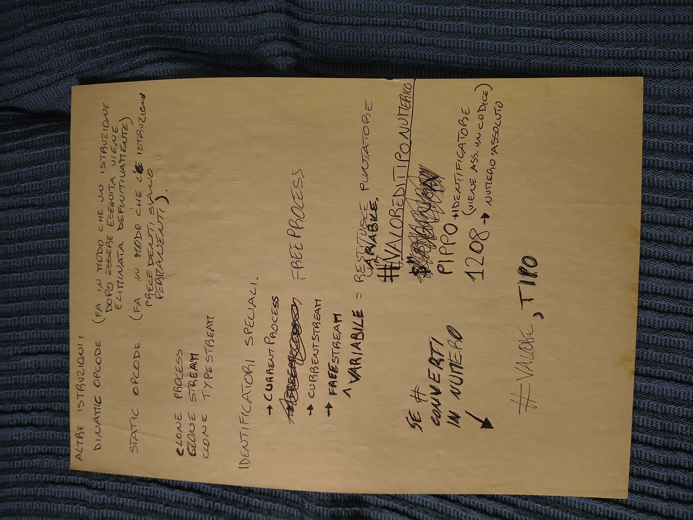

# Trascrizione — Opcode dinamico, clone e identificatori speciali

| | |
| --- | --- |
| Foto | [IMG_20261013_204008790_HDR.jpg](../IMG_20261013_204008790_HDR.jpg) |
| Scatto | 13 ottobre 2026 |
| Supporto | Foglio manoscritto. Due righe al centro sono cancellate. |
| Ordine di lettura | Istruzioni, clone, identificatori, poi l’esempio con #. |



## Testo

ALTRE ISTRUZIONI:

DINAMIC OPCODE (FA IN MODO CHE UN'ISTRUZIONE DOPO ESSERE ESEGUITA VIENE ELIMINATA DEFINITIVAMENTE)

STATIC OPCODE (FA IN MODO CHE LE ISTRUZIONI PRECEDENTI SIANO PERMANENTI).

```
CLONE PROCESS
CLONE STREAM
CLONE TYPESTREAM
```

IDENTIFICATORI SPECIALI.

```
-> CURRENT PROCESS
-> CURRENT STREAM
-> FREE STREAM
```

Una riga fra CURRENT PROCESS e CURRENT STREAM è cancellata. A destra della cancellatura resta leggibile FREE PROCESS.

```
^ VARIABILE = RESTITUISCE PUNTATORE VARIABILE.
```

SE # CONVERTI IN NUMERO

Sotto, un esempio cancellato a metà. Restano:

```
PIPPO     IDENTIFICATORE (VIENE ASS. UN CODICE)
1208      NUMERO ASSOCIATO
```

```
# VALORE, TIPO
```

Una riga sopra PIPPO, forse #VALOREDI TIPO NUMERICO, è barrata e non si legge per intero.

## Note di lettura

- «VIENE ELIMINATA» e «SIANO PERMANENTI» sono le concordanze del foglio.
- DINAMIC è senza la seconda A.
- FREE PROCESS appartiene alla riga cancellata: il nome a sinistra non si recupera.
- 1208 è il numero scritto accanto a PIPPO. Non è stato interpretato.
