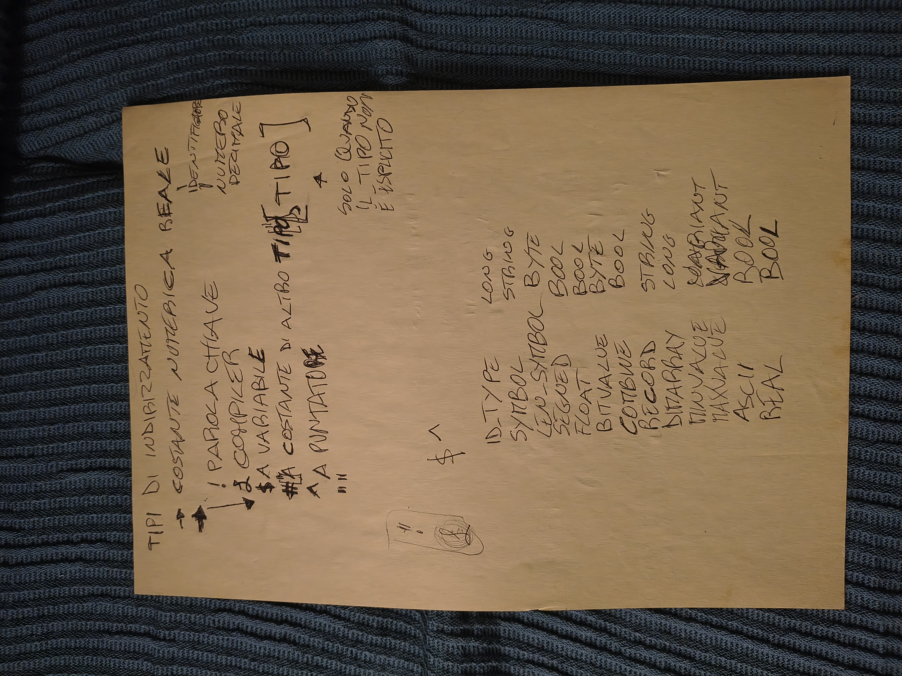

# Trascrizione — Tipi di indirizzamento e campi

| | |
| --- | --- |
| Foto | [IMG_20261013_204014881_HDR.jpg](../IMG_20261013_204014881_HDR.jpg) |
| Scatto | 13 ottobre 2026 |
| Supporto | Foglio manoscritto. Elenco dei prefissi in alto, tabella di campi in basso. |
| Ordine di lettura | Titolo e frecce, nota a destra, poi le due colonne. |



## Testo

TIPI DI INDIRIZZAMENTO

-> COSTANTE NUMERICA REALE

```
!   PAROLA CHIAVE
&   COMPILER
$   A VARIABILE
#   A COSTANTE DI ALTRO TIPO
^   A PUNTATORE
"   "
```

A destra, un riquadro:

```
IDENTIFICATORE
NUMERO DECIMALE
TIPO
```

con la freccia: SOLO QUANDO IL TIPO NON È ESPLICITO

In mezzo al foglio un piccolo disegno di un quadretto con " e, accanto, i segni $ ^

```
ID.TYPE       LONG
SYMBOL        STRING
LEN-SYMBOL    BYTE
SEGNO         BOOL
FLOAT         BOOL
BITVALUE      BYTE
COMBINE       BOOL
RECORD        STRING
DIMARRAY      LONG
MINVALUE      VARIANT
MAXVALUE      VARIANT
ASCII         BOOL
REAL          BOOL
```

## Note di lettura

- Il prefisso della costante di altro tipo è #. La parola TIPO è ripetuta e in parte corretta accanto alla riga.
- SEGNO è la lettura della riga il cui tipo è BOOL. Può essere SIGN, ma le lettere sono latine e chiudono in O.
- MINVALUE e MAXVALUE hanno VARIANT corretto sopra una parola precedente. La parola finale è VARIANT.
- FLOAT è associato a BOOL, come sul foglio.
- Le virgolette doppie sono una riga dell’elenco, senza glossa.
