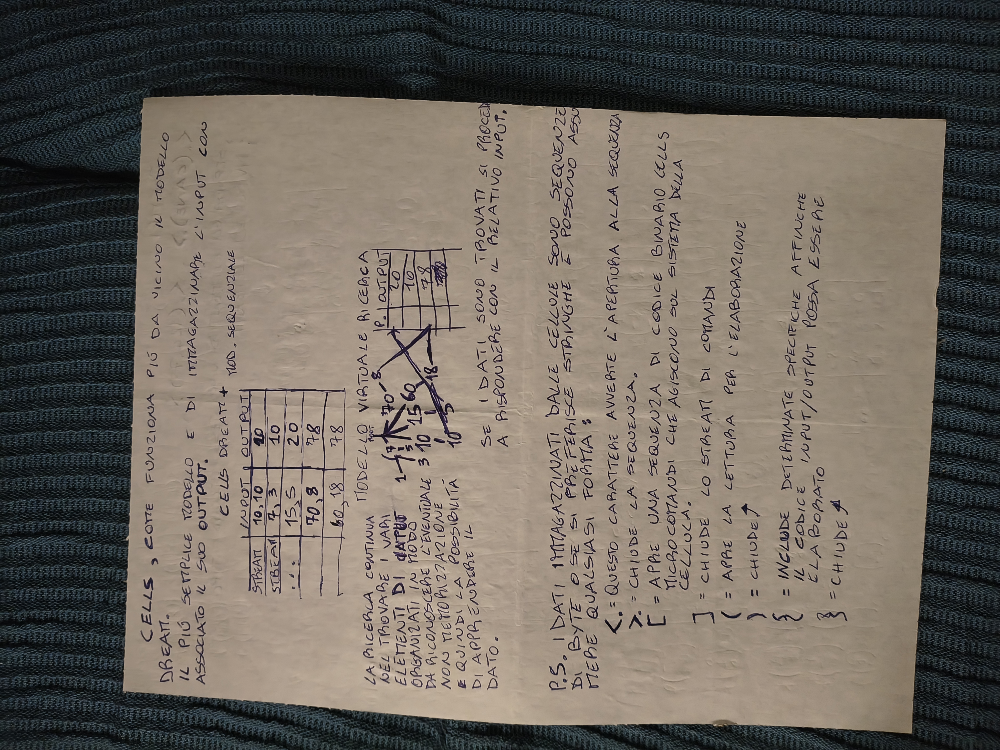

# Trascrizione — Cells, dream e sequenze di byte

| | |
| --- | --- |
| Foto | [IMG_20261013_204032745_HDR.jpg](../IMG_20261013_204032745_HDR.jpg) |
| Scatto | 13 ottobre 2026 |
| Supporto | Foglio manoscritto con due tabelle, uno schizzo di collegamenti e una legenda di segni. |
| Ordine di lettura | Titolo, tabella, nota e modello di ricerca, poscritto. |



## Testo

CELLS, COME FUNZIONA PIÙ DA VICINO IL MODELLO DREAM.

IL PIÙ SEMPLICE MODELLO È DI IMMAGAZZINARE L'INPUT CON ASSOCIATO IL SUO OUTPUT.

CELLS DREAM + MOD. SEQUENZIALE

```
STREAM    INPUT     OUTPUT
STREAM    10,10     20
STREAM    7,3       10
...       15,5      20
          70,8      78
          60,18     78
```

LA RICERCA CONTINUA NEL TROVARE I VARI ELEMENTI DI INPUT ORGANIZZATI IN MODO DA RICONOSCERE L'EVENTUALE NON MEMORIZZAZIONE E QUINDI LA POSSIBILITÀ DI APPRENDERE IL DATO.

MODELLO VIRTUALE RICERCA

Uno schizzo collega i numeri 1, 7, 10, 15, 60, 18, 5, 3 a una seconda tabella:

```
P.   OUTPUT
     20
     10
     78
```

L’ultima cella di questa tabella è barrata.

SE I DATI SONO TROVATI SI PROCEDE A RISPONDERE CON IL RELATIVO INPUT.

P.S. I DATI IMMAGAZZINATI DALLE CELLULE SONO SEQUENZE DI BYTE O SE SI PREFERISCE STRINGHE E POSSONO ASSUMERE QUALSIASI FORMA:

```
<  = QUESTO CARATTERE APRE L'APERTURA ALLA SEQUENZA
>  = CHIUDE LA SEQUENZA.
[  = APRE UNA SEQUENZA DI CODICE BINARIO CELLS
     MICROCOMANDI CHE AGISCONO SUL SISTEMA DELLA CELLULA.
]  = CHIUDE LO STREAM DI COMANDI
(  = APRE LA LETTURA PER L'ELABORAZIONE
)  = CHIUDE
{  = INCLUDE DETERMINATE SPECIFICHE AFFINCHÉ
     IL CODICE INPUT/OUTPUT POSSA ESSERE ELABORATO
}  = CHIUDE
```

## Note di lettura

- Le righe della prima tabella non sono tutte complete: i puntini stanno su una riga propria.
- «SI PROCEDE A RISPONDERE CON IL RELATIVO INPUT» è la frase del foglio. Non è stata cambiata in «output».
- «APRE L'APERTURA» è scritto così.
- «MICROCOMANDI» è una parola sola.
- I numeri nello schizzo sono collegati da tratti, non da una frase. L’ordine dei tratti non è stato trasformato in un algoritmo.
