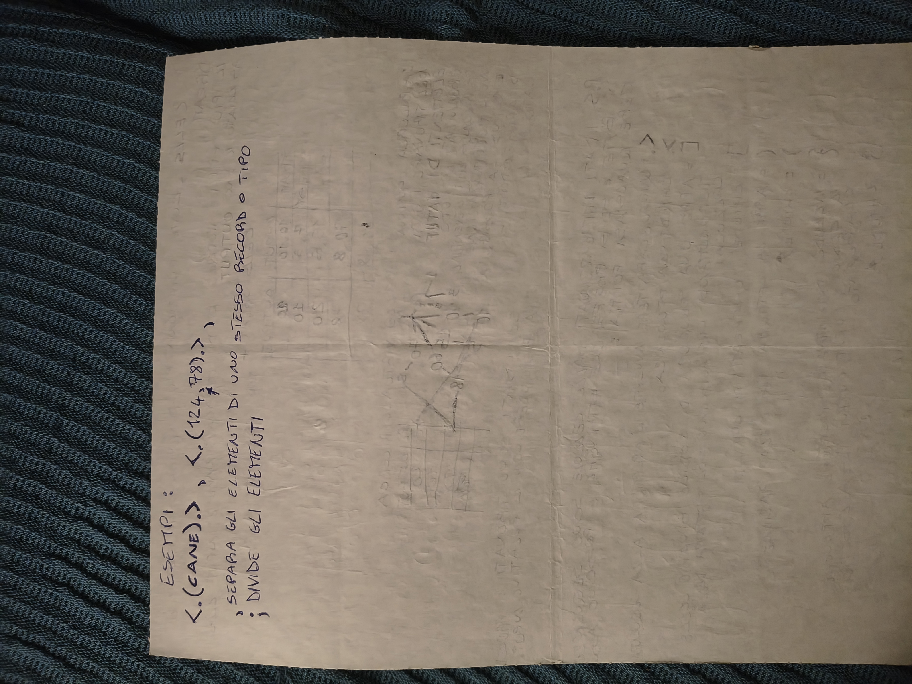

# Trascrizione — Esempi di sequenza, verso del foglio dream

| | |
| --- | --- |
| Foto | [IMG_20261013_204047831_HDR.jpg](../IMG_20261013_204047831_HDR.jpg) |
| Scatto | 13 ottobre 2026 |
| Supporto | Verso di [IMG_20261013_204032745_HDR.jpg](../IMG_20261013_204032745_HDR.jpg). In alto c’è inchiostro nuovo. Il resto è il testo dell’altra facciata che traspare, rovesciato. |
| Ordine di lettura | Solo le tre righe nuove. |



## Testo

ESEMPI:

```
<.(CANE).> , <.(124,78).>
```

, SEPARA GLI ELEMENTI DI UNO STESSO RECORD O TIPO

; DIVIDE GLI ELEMENTI

## Note di lettura

- La virgola e il punto e virgola sono i due segni spiegati, scritti a inizio riga.
- «124,78» ha una virgola interna. Il punto dopo la parentesi chiude l’esempio, come in `<.(CANE).>`.
- Tabelle e frasi visibili in chiaro appartengono all’altra facciata. Non sono state ricopiate.
