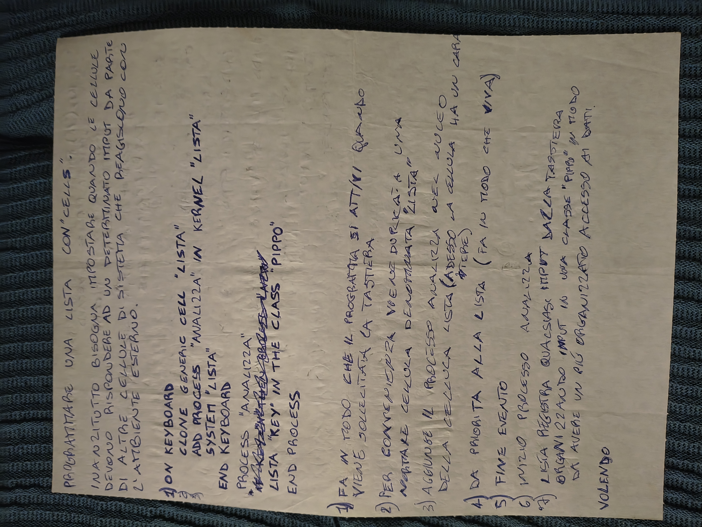

# Trascrizione — Programmare una lista con cells

| | |
| --- | --- |
| Foto | [IMG_20261013_204058627_HDR.jpg](../IMG_20261013_204058627_HDR.jpg) |
| Scatto | 13 ottobre 2026 |
| Supporto | Foglio manoscritto in inchiostro blu. Programma in alto, sette glosse numerate sotto. L’ultima riga è solo «VOLENDO». |
| Ordine di lettura | Titolo, programma, glosse. Una riga del programma è barrata. |



## Testo

PROGRAMMARE UNA LISTA CON "CELLS".

INNANZITUTTO BISOGNA IMPOSTARE QUANDO LE CELLULE DEVONO RISPONDERE AD UN DETERMINATO INPUT DA PARTE DI ALTRE CELLULE DI SISTEMA CHE REAGISCONO CON L'AMBIENTE ESTERNO.

```
1) ON KEYBOARD
     CLONE GENERIC CELL "LISTA"
     ADD PROCESS "ANALIZZA" IN KERNEL "LISTA"
     SYSTEM "LISTA"
   END KEYBOARD

   PROCESS "ANALIZZA"
   LISTA "KEY" IN THE CLASS "PIPPO"
   END PROCESS
```

Fra PROCESS "ANALIZZA" e LISTA c’è una riga barrata. Si intravede qualcosa come RECEIVE o KEY IN THE PROCESS. Non è recuperabile e non è stata ricostruita.

1) FA IN MODO CHE IL PROGRAMMA SI ATTIVI QUANDO VIENE SOLLECITATA LA TASTIERA

2) PER CONVENIENZA VIENE DUPLICATA A UNA NUOVA CELLULA DENOMINATA "LISTA"

3) AGGIUNGE IL PROCESSO ANALIZZA NEL NUCLEO DELLA CELLULA LISTA (ADESSO LA CELLULA HA UN CARATTERE)

4) DA PRIORITÀ ALLA LISTA (FA IN MODO CHE VIVA)

5) FINE EVENTO

6) INIZIO PROCESSO ANALIZZA

7) LISTA REGISTRA QUALSIASI INPUT DALLA TASTIERA ORGANIZZATO INPUT IN UNA CLASSE "PIPPO" IN MODO DA AVERE UN PIÙ ORGANIZZATO ACCESSO AI DATI.

VOLENDO

## Note di lettura

- I numeri 1, 2 e 3 sono anche nel margine del programma, allineati alle tre istruzioni dentro ON KEYBOARD.
- «UN CARATTERE» chiude la glossa 3. La parola è intera sul foglio; non è stata allungata.
- «DA PRIORITÀ» è senza apostrofo.
- «VOLENDO» non ha seguito su questa facciata.
- GENERIC, KEY, CLASS e PIPPO sono in inglese o in nome proprio, come scritti.
