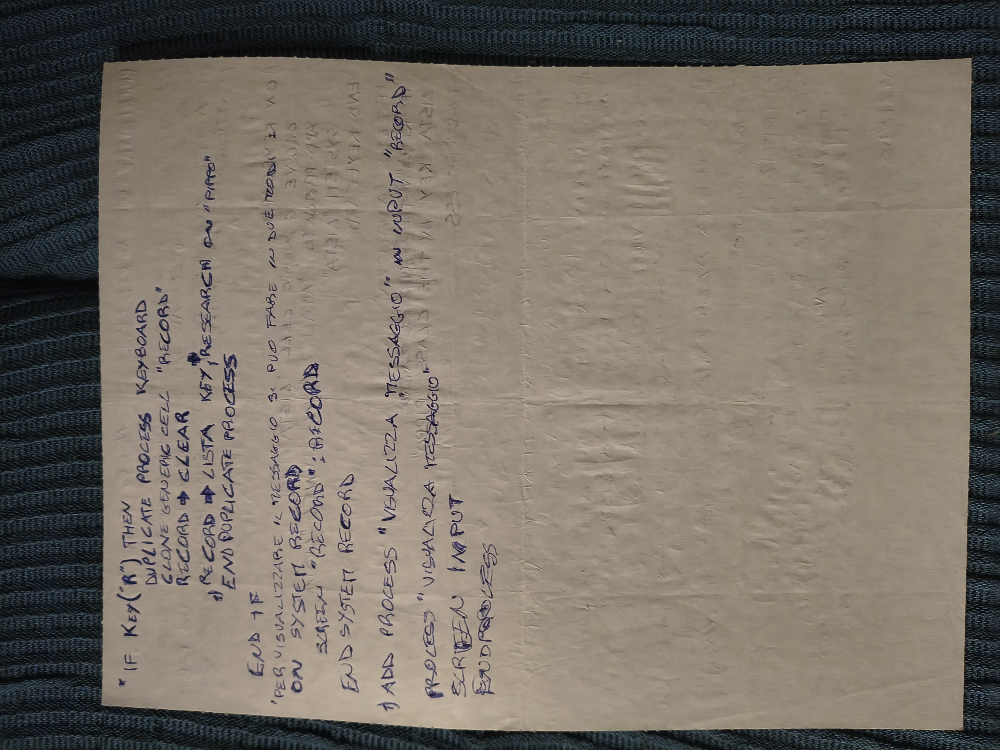

# Trascrizione — IF Key("R"), record e visualizza

| | |
| --- | --- |
| Foto | [IMG_20261013_204103084_HDR.jpg](../IMG_20261013_204103084_HDR.jpg) |
| Scatto | 13 ottobre 2026 |
| Supporto | Foglio manoscritto in blu, solo la parte alta. A destra traspare, rovesciato, il programma della lista. |
| Ordine di lettura | Il programma nuovo, dall’alto. Il testo rovesciato non è ricopiato. |



## Testo

```
* IF Key("R") THEN
    DUPLICATE PROCESS KEYBOARD
    CLONE GENERIC CELL "RECORD"
    RECORD = CLEAR
    RECORD = LISTA  KEY, RESEARCH ON "PIPPO"
    END DUPLICATE PROCESS
  END IF
```

' PER VISUALIZZARE IL MESSAGGIO SI PUÒ FARE IN DUE MODI O IN UN

```
ON SYSTEM RECORD
  SCREEN "RECORD" : RECORD
END SYSTEM RECORD
```

```
ADD PROCESS "VISUALIZZA MESSAGGIO" IN OUTPUT "RECORD"
PROCESS "VISUALIZZA MESSAGGIO"
SCREEN INPUT
END PROCESS
```

## Note di lettura

- La seconda riga del primo blocco è DUPLICATE PROCESS KEYBOARD. Nel foglio della lista il comando era CLONE. Qui i due verbi restano distinti.
- «RESEARCH ON "PIPPO"» è in inglese, sulla stessa riga di RECORD = LISTA.
- La nota sul visualizzare si interrompe dopo «O IN UN». Non c’è il secondo modo in prosa: sotto comincia ON SYSTEM RECORD.
- SCREEN compare due volte, una con "RECORD" : RECORD e una con INPUT.
- Il testo chiaro a destra è il verso di [IMG_20261013_204058627_HDR.jpg](../IMG_20261013_204058627_HDR.jpg).
