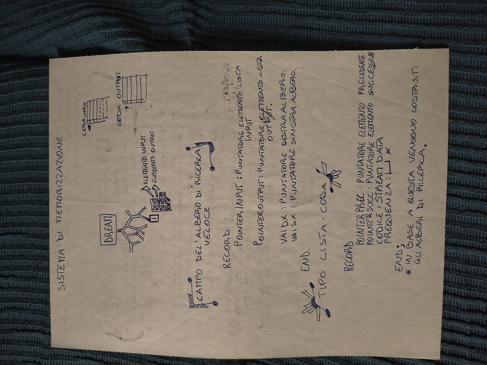

# Trascrizione — Sistema di memorizzazione, albero di ricerca

| | |
| --- | --- |
| Foto | [IMG_20261013_204113809_HDR.jpg](../IMG_20261013_204113809_HDR.jpg) |
| Scatto | 13 ottobre 2026 |
| Supporto | Foglio manoscritto in blu, ruotato. Schema di un albero e due record. |
| Ordine di lettura | Titolo in verticale, disegni a sinistra, campi al centro, chiusura a destra. |



## Testo

SISTEMA DI MEMORIZZAZIONE

Due griglie: CODA INPUT e CODA OUTPUT.

Un riquadro DREAM con un albero. Sui rami: ELEMENTO INPUT e ELEMENTO OUTPUT.

CAMPO DELL'ALBERO DI RICERCA VELOCE

RECORD

```
POINTER INPUT  : PUNTATORE ELEMENTO LISTA INPUT.
POINTER OUTPUT : PUNTATORE ELEMENTO LISTA OUTPUT.
VALDX          : PUNTATORE DESTRA ALBERO.
VALSX          : PUNTATORE SINISTRA ALBERO.
```

END.

TIPO LISTA - CODA

Un secondo albero, etichettato RECORD:

```
POINTER PREC : PUNTATORE ELEMENTO PRECEDENTE
POINTER SUCC : PUNTATORE ELEMENTO SUCCESSIVO
CODICE       : STREAM DATA
FREQUENZA    : 
```

END.

* IN BASE A QUESTA VENGONO COSTRUITI GLI ALBERI DI RICERCA.

## Note di lettura

- VALDX e VALSX sono scritti così, senza spazio.
- FREQUENZA non ha il tipo sulla stessa riga. C’è un segno dopo i due punti, non una parola.
- I due END chiudono i due record, non un programma.
- Gli alberi sono disegnati. I nomi dei nodi non vanno oltre ELEMENTO INPUT, ELEMENTO OUTPUT e le due etichette RECORD.
