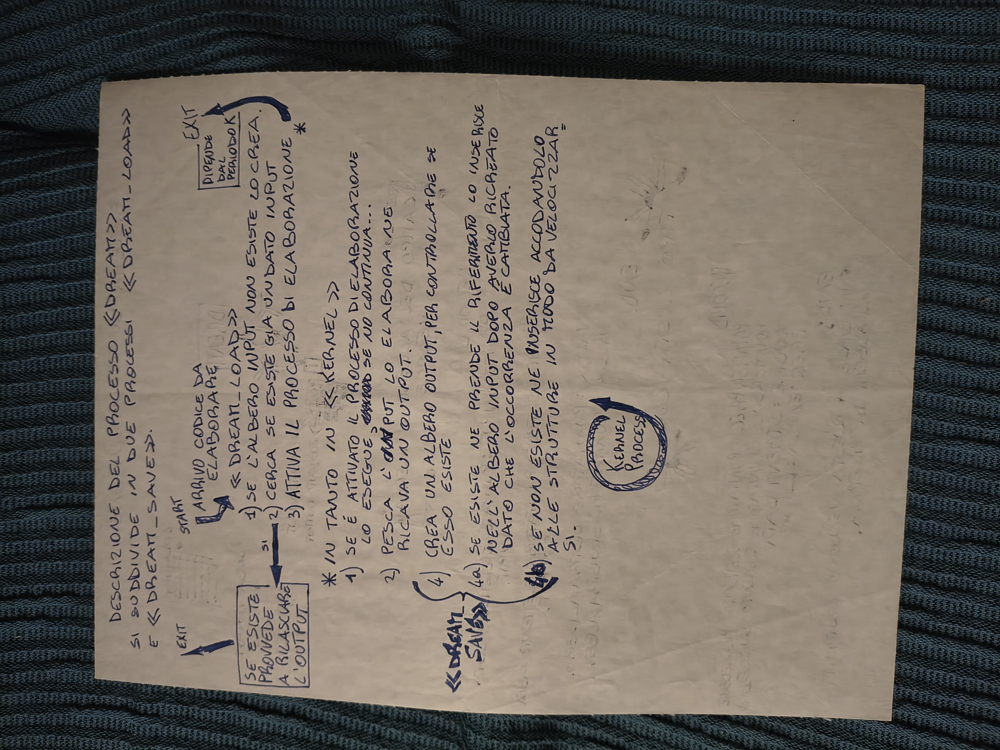

# Trascrizione — Dream load e dream save

| | |
| --- | --- |
| Foto | [IMG_20261013_204119326_HDR.jpg](../IMG_20261013_204119326_HDR.jpg) |
| Scatto | 13 ottobre 2026 |
| Supporto | Foglio manoscritto in blu, ruotato. Un flusso con START, EXIT e un cerchio KERNEL PROCESS. |
| Ordine di lettura | Titolo, colonna di sinistra dall’alto, poi i punti 1-4, poi DREAM SAVE. |

## Testo

DESCRIZIONE DEL PROCESSO <<DREAM>> SI SUDDIVIDE IN DUE PROCESSI, <<DREAM_LOAD>> E <<DREAM_SAVE>>.

START

AVVIO CODICE DA ELABORARE

<<DREAM_LOAD>>

1) SE L'ALBERO INPUT NON ESISTE LO CREA.
2) CERCA SE ESISTE GIÀ UN DATO INPUT
3) ATTIVA IL PROCESSO DI ELABORAZIONE *

EXIT, con la nota: DIPENDE DAL PROCESSO.

* IN TANTO IN <<KERNEL>>

1) SE È ATTIVATO IL PROCESSO DI ELABORAZIONE LO ESEGUE E DECIDE SE CONTINUA...
2) PESCA L'OUTPUT LO ELABORA E LO RICAVA UN OUTPUT.
4) CREA UN ALBERO OUTPUT, PER CONTROLLARE SE ESSO ESISTE

4a) SE ESISTE NE PRENDE IL RIFERIMENTO LO INSERISCE NELL'ALBERO INPUT DOPO AVERLO RICERCATO DATO CHE L'OCCORRENZA È CATASTATA.

4b) SE NON ESISTE NE INSERISCE ACCANTANDOLO ALLE STRUTTURE IN MODO DA VELOCIZZARE SI.

<<DREAM_SAVE>>

SE ESISTE PROCEDE A RILASCIARE L'OUTPUT

Un cerchio: KERNEL PROCESS

## Note di lettura

- Non c’è un punto 3 nel blocco KERNEL. Dopo il 2 viene il 4.
- «PESCA L'OUTPUT LO ELABORA E LO RICAVA UN OUTPUT» è una sola catena, senza punteggiatura.
- «NE INSERISCE» e «ACCANTANDOLO» sono le grafie del foglio.
- «CATASTATA» è intero e leggibile.
- La freccia di DREAM_SAVE punta al riquadro «SE ESISTE PROCEDE A RILASCIARE L'OUTPUT». Non c’è il ramo del caso contrario.
