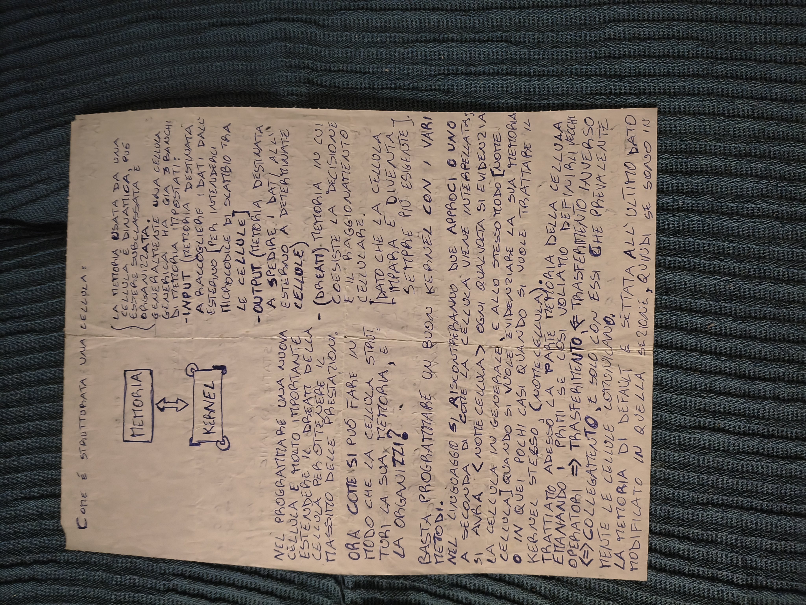

# Trascrizione — Come è strutturata una cellula

| | |
| --- | --- |
| Foto | [IMG_20261013_204138128_HDR.jpg](../IMG_20261013_204138128_HDR.jpg) |
| Scatto | 13 ottobre 2026 |
| Supporto | Foglio fitto, ruotato, in blu. A sinistra uno schema MEMORIA / KERNEL. Il testo corre in colonne strette. |
| Ordine di lettura | Domanda, schema, poi i blocchi nell’ordine in cui si susseguono sul foglio ruotato. Le righe tagliate restano tagliate. |



## Testo

COME È STRUTTURATA UNA CELLULA?

```
MEMORIA  <->  KERNEL
```

LA MEMORIA USATA DA UNA CELLULA È DINAMICA E PUÒ ESSERE SUBDIVISA IN PIÙ AREE ORGANIZZATE. UNA CELLULA IN GENERALE HA DUE AREE DI MEMORIA TIPI:

- UNA PER IL CODICE, DESTINATA ALLE ISTRUZIONI
- UNA PER I DATI

ESTERNO, PER INTENDERSI MICROCODICE DI SCAMBIO TRA LE CELLULE

- OUTPUT, MEMORIA DESTINATA A SPEDIRE I DATI ALL'ESTERNO A DETERMINATE CELLULE
- (DREAM) MEMORIA IN CUI COESISTE LA DECISIONE E IL RAGGIUNGIMENTO

DATO CHE LA CELLULA IMPARA E DIVENTA SEMPRE PIÙ ESISTE

SETTORE KERNEL CON I VARI METODI.

NEL PROGRAMMA DI UNA NUOVA CELLULA SI PUÒ TRATTARE L'ESTENSIONE DEL DREAM DELLA CELLULA PER OTTENERE IL TRASFERIMENTO DELLE PRESTAZIONI.

ORA COME SI PUÒ FARE IN MODO CHE LA CELLULA STRUTTURI LA SUA MEMORIA E LA ORGANIZZI?

BASTA PROGRAMMARE UN BUON KERNEL CON I VARI METODI.

NEL CASO SI INCONTRANO DUE APPROCCI, O UNO.

1. LA CELLULA (COME CELLULA) AVRÀ COME SETTORE UNA PARTE DI MEMORIA INTERPRETATA. LA CELLULA QUANDO SI VUOLE EVOLVERE PUÒ TRATTARE IL KERNEL STESSO (COME CELLULA). O IN QUEI POCHI CASI QUANDO SI VUOLE TRATTARE IL

TRATTATO ADESSO LA PARTE MEMORIA DELLA CELLULA PRENDENDO I DATI SE C'È BISOGNO DEI VARI ELEMENTI (SEPARATI) => TRASFERIMENTO E TRASFERIMENTO INVERSO. COLLEGAMENTO È SOLO CON ESSA CHE PERMETTE MENTRE LE CELLULE COMUNICANDO, LA MEMORIA DI DEFAULT È SETTATA ALL'ULTIMO DATO MODIFICATO IN QUELLA SEZIONE, QUINDI SE SONO IN

## Note di lettura

- «DUE AREE DI MEMORIA TIPI» è l’accordo del foglio.
- «COESISTE» è singolare, riferito nel testo a decisione e raggiungimento.
- «DIVENTA SEMPRE PIÙ ESISTE» non è stato completato. Manca la parola che sul foglio non si stacca dalla riga.
- Il punto 1 non ha un punto 2 scritto come tale. Il paragrafo «TRATTATO ADESSO» continua senza chiusura.
- L’ultima riga finisce con «SE SONO IN». Il foglio non ha il seguito in questa foto.
