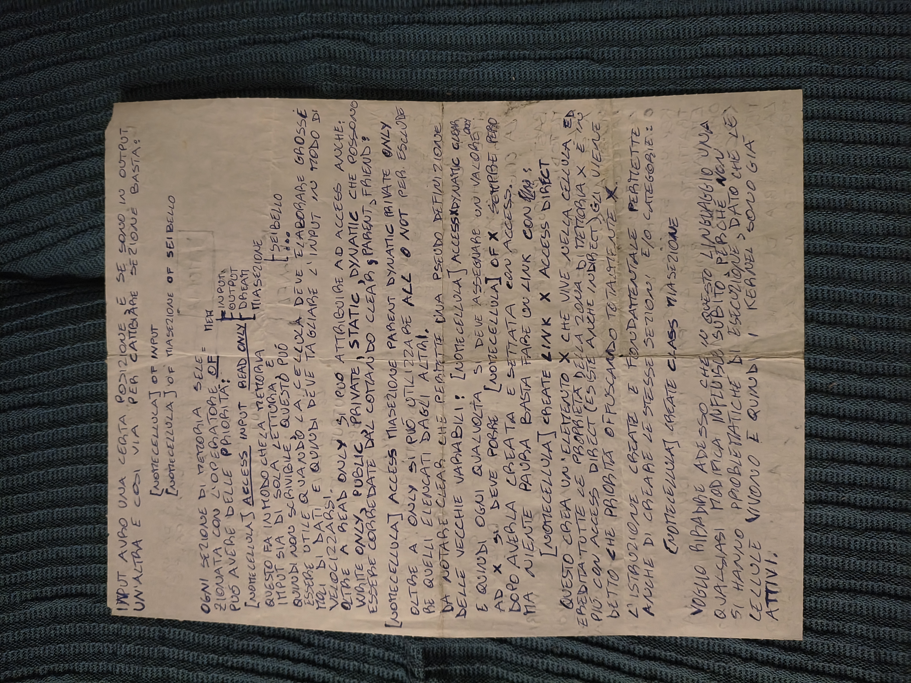

# Trascrizione — Sezioni di memoria, access e create

| | |
| --- | --- |
| Foto | [IMG_20261013_204144666_HDR.jpg](../IMG_20261013_204144666_HDR.jpg) |
| Scatto | 13 ottobre 2026 |
| Supporto | Foglio fitto, ruotato, scritto piccolo. Molte righe si perdono nel margine. |
| Ordine di lettura | Dall’alto del foglio ruotato. Le righe non stabili sono segnate e non completate. |



## Testo

INPUT AVERE UNA CERTA POSIZIONE E SE SONO IO OUTPUT UN'ALTRA E COSÌ VIA PER CAMBIARE SEZIONE BASTA:

```
[nomecellula] of input
[nomecellula] of output
[nomecellula] of [sezione]
```

OGNI SEZIONE DI MEMORIA SELEZIONATA CON LA SUA PROPRIETÀ…

```
[nomecellula] access input blind only
```

TRASMISSIONE

QUESTO FA IN MODO CHE LA MEMORIA RIMANGA IN SOLA LETTURA, È DUNQUE NON SCRIVIBILE. QUESTO PUÒ ESSERE UTILE…

PRIVATE, PUBLIC, READ ONLY. SI PUÒ ATTRIBUIRE AD ACCESS ANCHE: OLTRE A ONLY SI PUÒ UTILIZZARE ALL O NOT PER ESCLUDERE

```
[nomecellula] access [sezione] parent dynamic private only
```

IN ALTRE [parola] CLEAR, PER CONTRASTO CLEAR, DELLE VECCHIE VARIABILI.

```
[nomecellula] access dynamic
```

QUANDO AD X SI DEVE PORRE `[nomecellula] of x` SEMPRE PERÒ HA AVERE PRIORITÀ…

```
[nomecellula] create link x access direct
```

QUESTO CREA UN ELEMENTO X CHE VIVE NELLA CELLULA ED EREDITA TUTTE LE DIRETTIVE ANCHE QUANDO VIVE. DETTO CHE PRIORITÀ OFFUSCANDO TUTTE LE X

CREATE È FONDAMENTALE. PERMETTE ANCHE DI CHIAMARE LE STESSE SEZIONI IN CATEGORIE:

```
[nomecellula] create class [sezione]
```

VOGLIO RIPARARE ADESSO… QUESTO LINGUAGGIO UNA QUALSIASI… MA PIÙ DIFFICILE… PERCHÉ SE SI HANNO PROBLEMATICHE DI… CELLULE VINCOLO E QUINDI IL KERNEL POCO GIÀ ATTIVI.

## Note di lettura

- «SE SONO IO OUTPUT» è la lettura, non è stato cambiato in «se sono in output».
- «BLIND ONLY», «PARENT DYNAMIC PRIVATE ONLY», «CREATE LINK» e «CREATE CLASS» sono le formule più stabili.
- «OFFUSCANDO» e «VINCOLO» sono incerti. Restano perché le lettere ci si avvicinano, non perché il senso sia chiuso.
- I puntini sono righe presenti e non lette per intero. La foto è la fonte di quelle righe.
