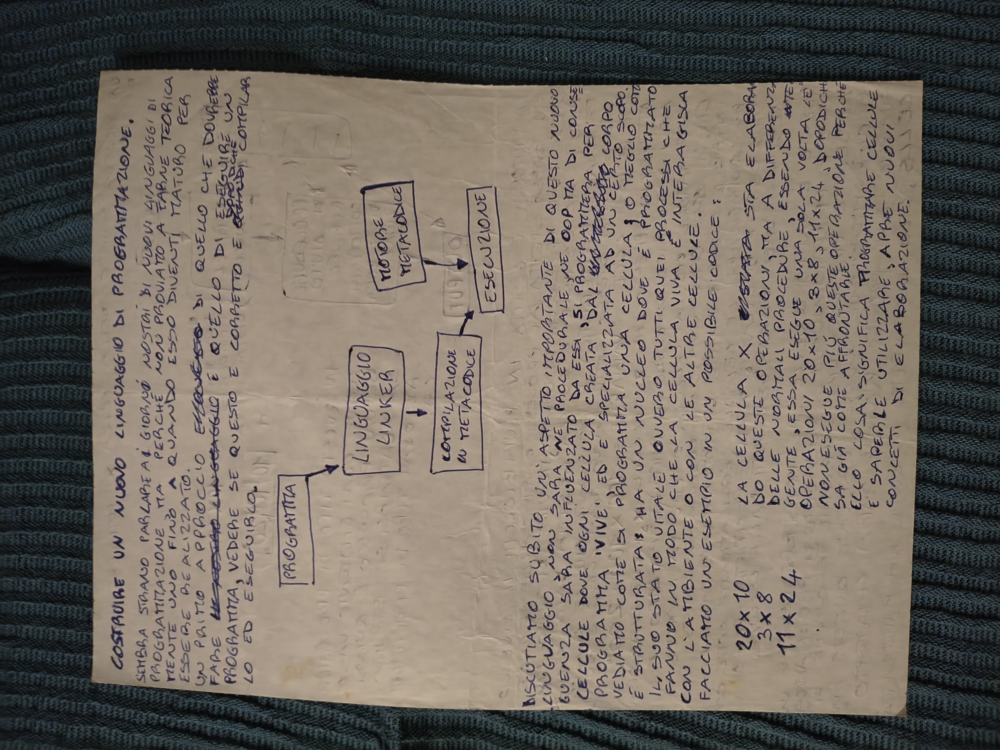

# Trascrizione — Costruire un nuovo linguaggio, prologatta

| | |
| --- | --- |
| Foto | [IMG_20261013_204209593_HDR.jpg](../IMG_20261013_204209593_HDR.jpg) |
| Scatto | 13 ottobre 2026 |
| Supporto | Foglio manoscritto in blu, ruotato. A destra uno schema, a sinistra un esempio con tre moltiplicazioni. |
| Ordine di lettura | Titolo, paragrafo, schema, poi l’esempio. |



## Testo

COSTRUIRE UN NUOVO LINGUAGGIO DI PROGRAMMAZIONE.

SARÀ STRANO PARLARE AI GIORNI NOSTRI DI NUOVI LINGUAGGI, DI ORGANIZZAZIONE, TRA PERCHÉ NON PROPRIO A FARE TEORIA ED ESSERE PIÙ ATTENTI…

FARE UN PUNTO A PROPOSITO È QUELLO DI SCEGLIERE UN PROGRAMMA, VEDERE SE QUESTO È CORRETTO E CONTINUARLO ED È ESEGUIRLO.

Schema, la parola in alto è PROLOGATTA. Da lì scendono tre rami:

```
LINGUAGGIO LINKER
CONTROLLORE [?]
MOTORE VIRTUALE
    ESECUZIONE
```

La parola del secondo riquadro non è stabile. Si legge qualcosa come CONTROLLORE, e sotto un complemento non sciolto.

ASCOLTATO SUBITO UN ASPETTO IMPORTANTE DI QUESTO NUOVO LINGUAGGIO: NON SARÀ UN PROGRAMMARE PER ORA DI COSE. CELLULE DOVE OGNI CELLULA CREATA DA ESSA HA PROLOGATTA. PER PROLOGATTA VIVE, ED È SPECIALIZZATA AD UN CERTO LAVORO E STRUTTURATA. HA UN NUCLEO DOVE È PROLOGATTATO IL SUO STATO…

IL SUO MODO CHE LA CELLULA VIVA È INTEGRARSI CON L'AMBIENTE O CON LE ALTRE CELLULE.

FACCIAMO UN ESEMPIO DI UN POSSIBILE CODICE:

```
20 x 10
 3 x  8
11 x 24
```

LA CELLULA X SARÀ STATA ELABORATA. DO QUESTE OPERAZIONI, TRA A DIFFERENZA DELLE NOSTRALI PROGRAMMAZIONI, ESEGUITO A TE GENTE, ESSA ESEGUE UNA SOLA VOLTA E OPERAZIONI 20x10, 3x8, 11x24. DOPODICHÉ NON ESEGUE PIÙ QUESTE OPERAZIONI PERCHÉ SA GIÀ COME AFFRONTARLE.

ELLO COSA SIGNIFICA PROGRAMMARE CELLULE È SAPERLE UTILIZZARE, APRE NUOVI CONCETTI DI ELABORAZIONE.

## Note di lettura

- PROLOGATTA è la grafia ripetuta. Non è stato normalizzato in Prolog. Può essere la stessa proposta in cui la cellula è la base e un livello di controllo sta sopra.
- «A TE GENTE» e «ELLO COSA» sono lasciati come si leggono.
- «DO QUESTE OPERAZIONI» non è stato cambiato in «fa queste operazioni».
- Il riquadro fra LINKER e MOTORE VIRTUALE non ha una lettura abbastanza ferma da entrare nel testo come parola unica.
- Questo foglio non è una pagina del manuale stampato firmato FraAgo.
