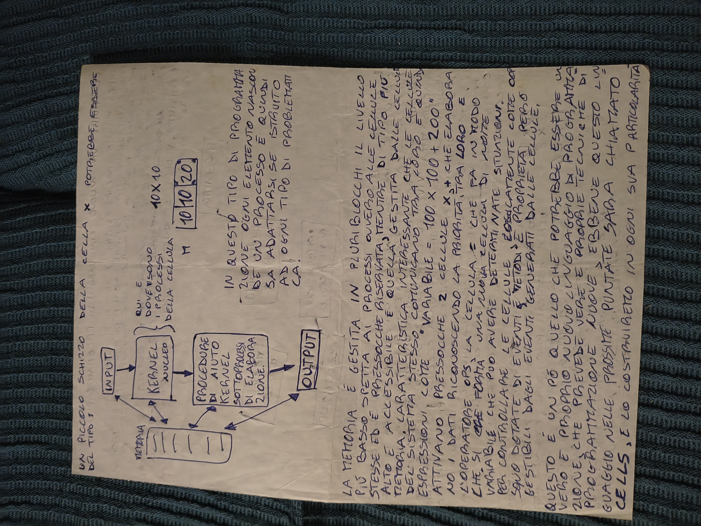

# Trascrizione — Schizzo della cellula e blocchi di memoria

| | |
| --- | --- |
| Foto | [IMG_20261013_204214619_HDR.jpg](../IMG_20261013_204214619_HDR.jpg) |
| Scatto | 13 ottobre 2026 |
| Supporto | Foglio manoscritto in blu, ruotato. Schema a destra, prosa a sinistra. |
| Ordine di lettura | Titolo e schema, numeri, poi la prosa. Le frasi che si interrompono restano interrotte. |



## Testo — schema

UN PICCOLO SCHIZZO DELLA CELLA X POTREBBE ESSERE DEL TIPO:

```
MEMORIA
  KERNEL / NUCLEO DELLA CELLULA
  INPUT
  PROCEDURE DI AIUTO KERNEL
  SOTTOPROCESSI DI ELABORAZIONE
OUTPUT
```

Accanto: DOVRANNO ESSERE PROCESSI DELLA CELLULA

Numeri scritti a parte:

```
10/10/20
40 x 10
M
```

IN QUESTO TIPO DI PROGRAMMA VIENE OGNI ELEMENTO NUOVO DI UN PROCESSO E QUANDO SA ADATTARSI, SE ISTRUITO, AD OGNI TIPO DI PROBLEMA.

## Testo — prosa

LA MEMORIA È GESTITA IN PIÙ BLOCCHI. IL LIVELLO PIÙ BASSO SPETTA AI PROCESSI, OVVERO ALLE CELLULE STESSE, ED È PRECISAMENTE RISERVATA. MEMORIA DI TIPO PIÙ ALTO E ACCESSIBILE È QUELLA GESTITA DALLE CELLULE. CARATTERISTICA INTERESSANTE: CHE LE CELLULE DEL SISTEMA STESSO CONTINUASSERO A ESSERE IN ESPANSIONE, COME

```
VARIABILE = 100 x 100 x 200
```

ATTIVANDO, PRESCELTE 2 CELLULE X + CHE ELABORANO I DATI RICONOSCENDO LA PRIORITÀ TRA LORO E COOPERANO PER LA CELLULA, E CHE FA IN MODO CHE SI PORTI UNA NUOVA CELLULA DI NOME VARIABILE, CHE PUÒ AVERE DETERMINATE SITUAZIONI.

PER CONTROLLARE LE CELLULE, ESCLUSIVAMENTE COME SONO DOTATE DI EVENTI. VEDO È PROPRIETÀ, PERÒ, ESISTIBILI DAGLI EVENTI GENERATI DALLE CELLULE.

QUESTO È UN PO' QUELLO CHE POTREBBE ESSERE UN VERO E PROPRIO NUCLEO. LINGUAGGIO DI PROGRAMMAZIONE IN CUI LE PIÙ EVIDENTI NUOVE E PROPRIE TECNICHE DI PROGRAMMAZIONE. NELLE POSSIBILI PUNTATE SARÀ CHIAMATO CELLS, E LO COSTRUIREMO IN OGNI SUA PARTICOLARITÀ.

## Note di lettura

- «CELLA» nel titolo e «CELLULE» nel testo convivono sullo stesso foglio.
- «CONTINUASSERO» è il tempo scritto, non «continuassero a espandersi» completato.
- «VEDO È PROPRIETÀ» e «ESISTIBILI» sono lasciati così.
- 10/10/20, 40x10 e M non hanno una didascalia. Non sono stati letti come una data.
- «PUNTATE» può essere «PUNTATE» o «PUNTE». La frase «SARÀ CHIAMATO CELLS» è stabile.
