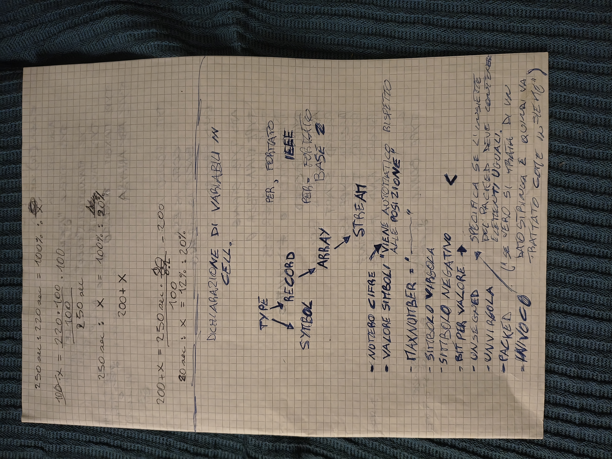

# Trascrizione — Dichiarazione di variabili e conti sul foglio a quadretti

| | |
| --- | --- |
| Foto | [IMG_20261013_204224123_HDR.jpg](../IMG_20261013_204224123_HDR.jpg) |
| Scatto | 13 ottobre 2026 |
| Supporto | Foglio a quadretti. A destra conti con le percentuali. Al centro l’albero dei tipi. A sinistra note sul formato dello stream. |
| Ordine di lettura | Conti, poi TYPE / STREAM, poi le note a sinistra. |



## Testo — conti

```
250 acc + 220 acc = 100% : x
100 + x = 220 · 100 · 100
= 100

250 acc : x = 100% : 20%
200 + x

200 + x = 250 acc · … = 200
20 acc : x = 12% : 20%
100
```

Il fattore fra 250 acc e 200 è corretto sul foglio e non si legge per intero. Il risultato scritto è 200.

## Testo — dichiarazione

DICHIARAZIONE DI VARIABILI IN CELL.

```
TYPE
  RECORD     PER, FORMATO IEEE
  SYMBOL     PER, FORMATO BASE 2
  ARRAY
STREAM
  NUMERO CIFRE
  VALORE SIMBOLI   VIENE AUTOMATICO RISPETTO ALLE POSIZIONI
  MAXNUMBER = "        "
  SIMBOLO VIRGOLA
  SIMBOLO NEGATIVO     <
  BIT PER VALORE
  UNSIGNED
```

Note in margine, nell’ordine in cui stanno:

- UNIVARIABILE. Se vero si tratta di un PACKED. Basta una e nessuna va trattato come un intero.
- PACKED
- WING = 0, lettura incerta del nome.

## Note di lettura

- «acc» torna in tutti i conti. Non è stato sciolto in una parola.
- IEEE e BASE 2 sono le due glosse di RECORD e SYMBOL. ARRAY non ha glossa.
- «VIENE AUTOMATICO RISPETTO ALLE POSIZIONI» è l’accordo del foglio.
- Il nome segnato WING può essere un’altra parola breve. Non è stato indovinato.
- «nessuna va trattato» è scritto così.
