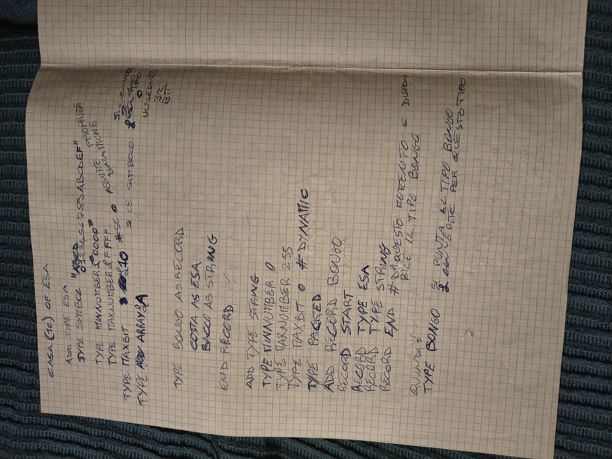

# Trascrizione — CASA (10) OF ESA, foglio a quadretti

| | |
| --- | --- |
| Foto | [IMG_20261013_204232867_HDR.jpg](../IMG_20261013_204232867_HDR.jpg) |
| Scatto | 13 ottobre 2026 |
| Supporto | Foglio a quadretti, scritto in colonne dall’alto verso il basso e poi a sinistra. Diverse righe sono corrette. |
| Ordine di lettura | Intestazione, tipo ESA, record, tipo stringa, record BOLOG, tipo BONGO. I nomi propri sono quelli che si leggono, non nomi ripuliti. |



## Testo

```
CASA (10) OF ESA

ADD TYPE ESA
TYPE SYMBOL "0123456789ABCDEF"
TYPE MAXNUMBER & FFFF
TYPE MAXNUMBER & 0000
TYPE MAXBIT 0
TYPE [barrato]

TYPE [nome barrato] AS RECORD
  [campo] AS ESA
  [campo] AS STRING
END RECORD

ADD TYPE STRING
TYPE MAXNUMBER 0
TYPE MAXNUMBER 255
TYPE MAXBIT 0   # DYNAMIC
TYPE PACKED

ADD RECORD BOLOG
RECORD START
  RECORD TYPE ESA
  RECORD TYPE STRING
RECORD END
  # PROGETTO MORTO = DISCO
  DICE IL TIPO BOLOG

TYPE BONGO
  PUNTA AL TIPO BOLOG
  SI ESEGUE PER QUESTO TIPO
```

Accanto a SYMBOL c’è una glossa breve, forse POPOLATI o un’altra parola di sei o sette lettere. Non è stabile.

Una colonna di numeri e di segni, fra cui 40 e 0, sta a margine del tipo ESA. Non forma una frase.

## Note di lettura

- CASA può leggersi CASE. La lettera centrale in questa foto è una A, ed è stata tenuta.
- BOLOG e BONGO sono le letture dei due nomi di tipo. Non sono stati sostituiti con parole italiane vicine.
- I due campi del record hanno nomi propri corretti o piccoli. Sono lasciati fra quadre perché una lettura tipo COSTA / BACCO non è abbastanza ferma.
- «# PROGETTO MORTO = DISCO» e «DICE IL TIPO BOLOG» sono righe di commento sotto RECORD END.
- «PUNTA AL TIPO BOLOG» è la glossa di TYPE BONGO.
- Questo è l’ultimo foglio della serie fotografata il 13 ottobre 2026.
